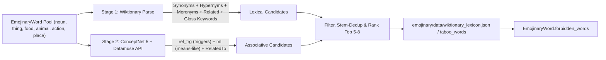
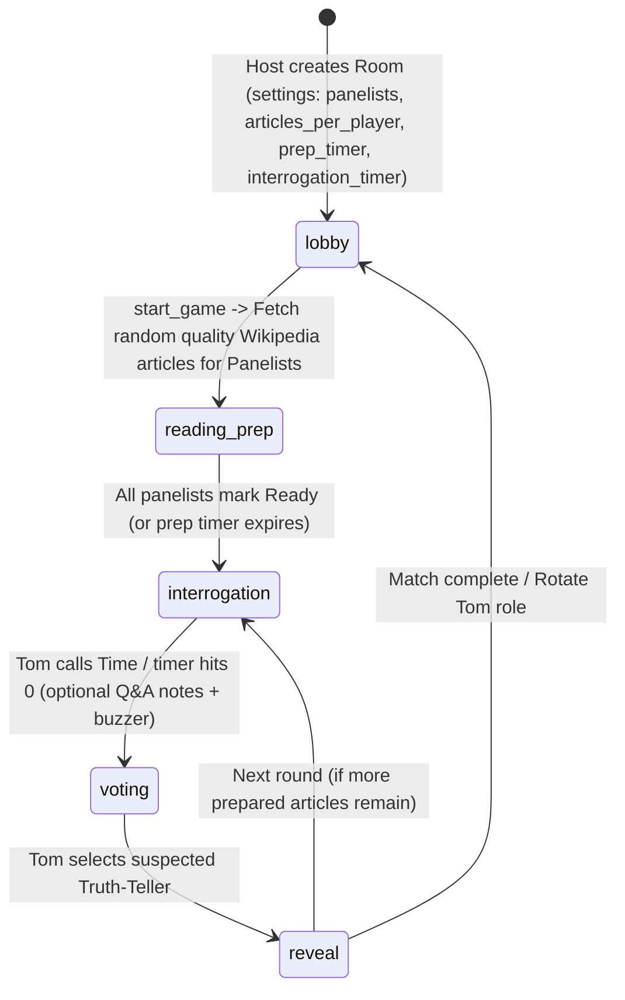
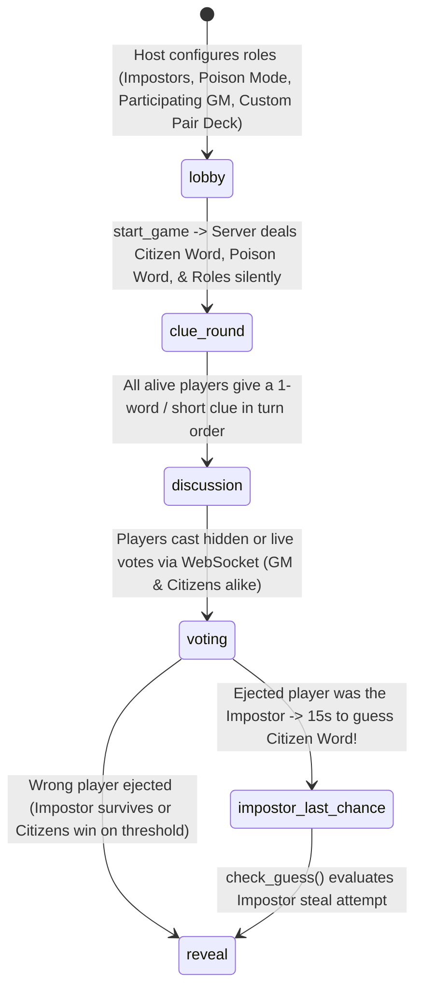

# Word Party Games & "Two of These People Are Lying" — Feasibility & Architecture Plan

> **Purpose**: Evaluate the 17 word-based party games featured in [Tabletop Bellhop's *Best Word Games*](https://tabletopbellhop.com/gaming-advice/best-word-games/) plus **Two of These People Are Lying**, design the **forbidden/related words pipeline** (Wiktionary vs. ConceptNet/Datamuse), and blueprint the Wikipedia bluffing game for `marco-silva.com`.

---

## 1. Executive Summary & Feasibility Matrix

Our existing `marco-silva.com` multiplayer stack (`gamerooms.Room`, Redis JSON state + fallback, Django Channels `AsyncJsonWebsocketConsumer`, `get_sanitized_player_view()`, `EmojinaryWord` with `7,824` seeded rows & `3,671` Wiktionary entries, and `lupus` role mechanics) already solves 70%+ of the infrastructure needed for multiplayer browser party games: **room codes, QR joins, password gates, persistent player tokens, reconnect recovery, spoiler-protected view sanitization, synchronized timers, and match replay export**.

| # | Game | Players | Browser / Mobile Fit | Reuse of Current Stack | Data / Lexicon Requirement | Build Effort | Recommendation |
|---|---|---:|---|---|---|---|---|
| 1 | **Two of These People Are Lying** | 3–8+ | ⭐⭐⭐⭐⭐ | `gamerooms` + `emojinary` sanitized views | Wikipedia MediaWiki REST/Action API (`/random/summary`, `mobile-html`) | **M** | **Build Next** (Flagship social bluffing game) |
| 2 | **Advanced Word Impostor (Poison Word + Participating GM)** | 3–12+ | ⭐⭐⭐⭐⭐ | `lupus` voting/deduction + `emojinary` sanitized views | Wiktionary `====Coordinate terms====` + co-topic `(Secret Word, Poison Word)` pairs | **M** | **Build Next** (Flagship #2 social word game) |
| 3 | **Just One** | 3–9 | ⭐⭐⭐⭐⭐ | `emojinary` Collective `prep` + `guess` phases | `EmojinaryWord` + `_normalize_phrase()` + Wiktionary `aliases`/stems | **S** | **Phase 1** (Drop-in party mode) |
| 4 | **Balderdash** | 3–10 | ⭐⭐⭐⭐⭐ | `emojinary` `submitting` + `judging` phases | Obscure Wiktionary headwords + real `definition` / `etymology` | **S** | **Phase 1** (Already have Wiktionary definitions) |
| 5 | **Taboo** | 4–12 | ⭐⭐⭐⭐⭐ | `emojinary` `guess` chat + timer + spoiler guard | `EmojinaryWord` + `forbidden_words` (Wiktionary + ConceptNet/Datamuse) | **S–M** | **Phase 1** (Needs `forbidden_words` backfill) |
| 6 | **Trapwords** | 4–10 | ⭐⭐⭐⭐ | `Taboo` engine + opponent `prep` phase | Opponent-entered trap words + curse modifiers (no pre-seeded list needed!) | **M** | **Phase 1–2** (Zero static data bottleneck) |
| 7 | **Werewords** | 4–10+ | ⭐⭐⭐⭐⭐ | Hybrid of `lupus` roles + `emojinary` secret words | `EmojinaryWord` + role deck (`Mayor`, `Seer`, `Werewolf`, `Villager`) | **M** | **Phase 1–2** (Perfect bridge between our two apps) |
| 8 | **Medium** | 2–8 | ⭐⭐⭐⭐ | Simultaneous secret submit + reveal loop | `EmojinaryWord` pairs (`noun` / `thing` / `place` / `action`) | **S** | **Phase 2** |
| 9 | **Apples to Apples** | 4–10 | ⭐⭐⭐⭐ | `emojinary` `best_guess` (Judge's Pick) loop | `noun`/`thing`/`person` hand cards + `adjective` prompt cards (`wordlists.json`) | **S** | **Phase 2** (We already have `adj` + `noun` pools) |
| 10 | **Codenames** | 4–12 | ⭐⭐⭐⭐⭐ | New game app `codenames` on `gamerooms` + `Channels` | 25-word 5x5 board + Spymaster-only keycard in `get_sanitized_player_view()` | **M–L** | **Phase 2** (Highest demand classic) |
| 11 | **Decrypto** | 4–8 | ⭐⭐⭐⭐ | New 2-team state schema (`white` / `black` teams) | 4 persistent keyword cards per team + numeric code triplets + interception log | **M–L** | **Phase 2** |
| 12 | **Tapple** | 2–8+ | ⭐⭐⭐⭐ | Hot-potato turn rotation + 10s countdown timer | Broad category prompts + 26-letter disabled-switch state + Wiktionary headword validation | **S–M** | **Phase 2** |
| 13 | **Train of Thought** | 3–8 | ⭐⭐⭐ | Turn clue chat + progressive guess log | Pairs of `EmojinaryWord` cards + 3-word clue validator | **S** | **Phase 3** |
| 14 | **When I Dream** | 4–10 | ⭐⭐⭐ | `lupus` spirit alignments (`Fairy`/`Boogeyman`/`Sandman`) + word stream | 1-word clues + timed dream recall voting | **M** | **Phase 3** |
| 15 | **Letter Jam** | 2–6 | ⭐⭐⭐ | Complex asymmetric card-visibility matrix | 5-letter hidden word sets + letter token tracker (heavy UI) | **L** | **Phase 3** |
| 16 | **Knit Wit** | 2–8 | ⭐⭐ | Venn-loop UI is awkward on small phones | Trait adjectives + human or LLM-assisted answer scoring | **L** | **Low Priority** |
| 17 | **Word on the Street** | 2–8 | ⭐⭐ | Simultaneous consonant tug-of-war board | English dictionary validation (`wordlists.json` + Wiktionary) | **M** | **Low Priority** (Better physical) |
| 18 | **Bananagrams** | 2–8 | ⭐⭐ | 144-tile drag-and-drop crossword grid per phone | Full Scrabble dictionary check + grid connectivity check | **L** | **Skip / Low Priority** |
| 19 | **Spell Smashers** | 2–5 | ⭐⭐ | RPG shop + HP + hand-of-letters engine | Custom monster/gear decks + dictionary validation | **L** | **Skip / Low Priority** |

---

## 2. Deep Dive: Forbidden & Related Words — Do We Store Them, and Can Wiktionary Generate Them?

### Short Answer
1. **Yes, we should precompute and store `forbidden_words`** directly on `EmojinaryWord` (and optionally in a standalone JSON seed file like `emojinary/data/taboo_cards.json`), rather than querying external APIs during live gameplay. Live gameplay needs sub-millisecond validation on every chat message.
2. **Wiktionary gets us ~50–60% of the way there automatically**, because it gives us lexical relations — **not** intuitive human association ("what pops into your head first"). Combining **Wiktionary + ConceptNet / Datamuse** produces near-board-game quality Taboo cards automatically.

### Why Wiktionary Alone Is Not Enough for Taboo

Consider the secret word **`Coffee`**:
- **What Wiktionary stores**:
  - `====Synonyms====`: *java*, *joe*, *cuppa*
  - `====Hypernyms====`: *beverage*, *infusion*
  - `====Related terms====`: *caffeine*, *coffeehouse*, *coffeeshop*
  - Definition words: *roasted*, *seeds*, *beans*, *drink*, *tropical*
- **What Wiktionary often misses (but players ALWAYS say in Taboo)**:
  - *morning*, *mug*, *cup*, *espresso*, *latte*, *starbucks*, *wake*, *hot*, *tea*

Or consider **`Beach`**:
- **Wiktionary**: *shore*, *coast*, *pebble*, *sand*, *wave*, *tide* (good!)
- **Human Taboo instincts**: *sun*, *ocean*, *sea*, *bikini*, *vacation*, *towel*, *swim*

### The Recommended Hybrid Enrichment Pipeline (`scripts/enrich_taboo_words.py`)

We can extend our existing batch harvesting architecture (`scripts/enrich_wiktionary.py`) into a two-stage offline compiler:



#### Concrete Data Sources (All Open-License / API-Friendly)
1. **English Wiktionary (`CC BY-SA 4.0`) — Extend `scripts/enrich_wiktionary.py`**:
   - Parse wikitext sections we don't currently save:
     - `====Synonyms====`, `====Antonyms====`
     - `====Hypernyms====`, `====Hyponyms====`, `====Coordinate terms====`
     - `====Meronyms====`, `====Holonyms====`, `====Derived terms====`, `====Related terms====`
   - Extract high-signal nouns/verbs/adjectives from `definition` (excluding English stopwords like *something*, *used*, *small*, *type*).
2. **Datamuse API / ConceptNet 5 (`CC BY-SA 4.0` / WordNet)**:
   - `https://api.datamuse.com/words?rel_trg=<word>&max=12` returns strongly co-occurring human trigger words (e.g., for `coffee` -> `morning`, `tea`, `cup`, `mug`, `caffeine`, `drink`, `latte`).
   - `https://api.datamuse.com/words?ml=<word>&max=10` returns semantic neighbors.
   - Because this runs offline once in `scripts/` (just like `build_wordlists.py` and `enrich_wiktionary.py`), there is **zero runtime external API latency** during a game.

### Proposed Schema & Server-Side Guard

In `emojinary/models.py`:
```python
forbidden_words = models.JSONField(default=list, blank=True)  # e.g. ["bark", "puppy", "pet", "bone", "leash"]
obscurity = models.PositiveSmallIntegerField(default=1)  # 1=everyday, 2=uncommon, 3=Balderdash-obscure
```

In `emojinary/game_state.py`, we already have `_normalize_phrase()` and `censor_spoilers()`. We generalize that into a **server-side Taboo Validator**:
- Blocks exact matches of the target word, any inflected/plural form (`dogs`, `running`), substring containment (`fireman` for `fire`), any word in `forbidden_words`, and high-similarity typos (`difflib.SequenceMatcher >= 0.85`).
- In **Live Text Mode**, the WebSocket consumer intercepts the clue-giver's clue *before* broadcasting it, marks it `🚨 BUZZED!` (deducting `-1 pt` or skipping the card), or rejects the clue cleanly if a "strict filter" room setting is toggled.
- In **Voice / Living-Room Table Mode**, the opposing team sees the **"🔴 BUZZER!"** button alongside the secret word + its 5 forbidden words and taps it live when the clue-giver slips up verbally — solving the latency problem when friends play together on a couch or Discord call!

### Bonus: Using Wiktionary Specifically for **Balderdash** & **Just One**
- **Balderdash**: Harvest obscure/archaic English Wiktionary entries (e.g., *petrichor*, *defenestrate*, *snollygoster*, *borborygmus*, *callipygian*, *ugsome*, *absquatulate*) using Wiktionary category members (`Category:English rare terms`, `Category:English archaic terms`, `Category:English humorous terms`) and store the real concise `definition` (`obscurity = 3`). Because our Wiktionary field already stores `definition`, `balderdash` mode works out of the box.
- **Just One**: Use Wiktionary `aliases` + morphological prefix checks (`dog`/`dogs`, `prince`/`princess`, `fire`/`flame`) to **automatically flag or cancel duplicate/same-family clues** before showing the surviving clues to the guesser.

---

## 3. Architectural Fit: How These Word Games Plug Into `marco-silva.com`

### Option A: New Modes Inside Existing `emojinary` Engine (Fastest — `S` Effort)
`emojinary` already has Redis state persistence, WebSocket consumer (`EmojinaryConsumer`), `RoundRobinMixin` (`prep`, `emoji`/`clue`, `guess`), `BestGuessMixin` (`picking`, `submitting`, `judging`), spoiler censorship, and round replays. The following games map directly onto those state machines:

1. **`just_one` Mode**:
   - Reuse Collective `prep` -> all $N-1$ clue-givers submit 1 word simultaneously.
   - Server runs deduplication (`_normalize_phrase()` + Wiktionary `aliases`/stem equality) -> marks collisions as `❌ cancelled`.
   - Guesser sees only the surviving unique clues and guesses using `check_guess()`.
2. **`taboo` / `trapwords` Mode**:
   - Clue-giver sends text clues in chat (or speaks on call/table while opponents hold a **🚨 Buzzer** button).
   - For `trapwords`, swap the first 25 seconds to a `prep` step where Team B types `3–5` secret trap words for Team A's word (neither side sees the full overlap until a trap triggers!).
3. **`balderdash` Mode**:
   - Reuse `BestGuessMixin` (`submitting` -> `judging`): server deals an `obscurity == 3` word to everyone, hides `definition`, collects anonymized fake definitions in `submitting`, shuffles the real Wiktionary `definition` alongside player bluffs, and scores `judging` votes (`+2` for guessing real truth, `+1` per fooler).
4. **`werewords` ("Lupus Words") Mode**:
   - Reuse `lupus` role dealing (`Mayor` picks difficulty/word, `Seer` knows secret word silently, `Werewolf` knows secret word silently and tries to steer guesses wrong) + fixed quick-tap responses (`✅ Yes`, `❌ No`, `🤔 Maybe`, `🔥 So Close`).

### Option B: Dedicated Game Apps on `gamerooms` (`Codenames`, `Decrypto`, `Two of These People Are Lying`)
Look at `gamerooms/models.py` (`Room.game_type`), `gamerooms/urls.py`, and `website/asgi.py`: adding a crisp new Django app (like `lupus/` or `emojinary/`) registers cleanly under `/games/<game>/` and `/ws/<game>/<code>/`, using the exact same QR invite, password protection, and `/games/` hub card pattern.

---

## 4. Implementation Blueprint: *"Two of These People Are Lying"*

> Inspired by Tom Scott & The Technical Difficulties: panelists secretly read random Wikipedia articles beforehand. A single article title is drawn as the prompt — **only one panelist actually read that article** while the remaining panelists must **improvise convincing lies** on the spot. **"Tom" (the Interrogator)** cross-examines the panel to figure out who is telling the truth.

### 4.1 Gameplay Flow & State Machine



#### Role Breakdown per Round
- **Interrogator ("Tom")**: Rotates each round (or stays fixed if "Fixed Host Mode" is toggled in settings). Knows **only the Article Title** (plus optional broad category badge). Can ask voice questions (in-person / Discord) **or** send typed interrogation prompts in the room's Q&A log.
- **Panelists (2–6 players)**: During `reading_prep`, each panelist is secretly dealt `K` random Wikipedia articles (default `3`, configurable `1–5`) and can re-roll stubs/boring topics (`allow_rerolls`).
- **Round Selection**: When `interrogation` begins, the engine picks **1 unused article** from one panelist's stack:
  - That panelist becomes the **Truth-Teller** (`is_truth: true`) and sees their **embedded Wikipedia Reader** right on screen so they can reference facts while answering without leaving the tab.
  - All other panelists become **Liars / Bluffers** (`is_truth: false`) and see **only the Article Title** + a *"🎭 Bluff! Make up believable facts about this title"* banner.

---

### 4.2 Embedding & Serving Wikipedia Articles Safely (Anti-Cheat + Mobile UX)

Naively dropping `<iframe src="https://en.wikipedia.org/wiki/...">` directly into the page has **two subtle pitfalls**:
1. **Anti-Cheat Leak**: If the URL or iframe exists anywhere in the DOM/HTML or WebSocket payload for all players and is merely hidden with CSS (`display: none`), any player (or Tom!) could press **Inspect Element / DevTools** and read the truth article URL or body!
2. **Mobile Iframe Friction**: Raw desktop Wikipedia inside a small mobile `<iframe>` shows navigation sidebars, edit links, donate banners, and tiny scrolling boxes.

#### Recommended Solution: Server-Sanitized Wikipedia Reader + Optional Full-Page Frame

1. **Strict Server-Side Secrets Filtering (`get_sanitized_player_view(state, viewer_id)`)**:
   - The full article `payload` (summary, sections, thumbnail, canonical URL) lives **only** inside Redis `state["articles_pool"]`.
   - **During `reading_prep`**: Player A receives *only* Player A's `K` assigned articles; Tom receives `"⏳ Panelists are reading their random Wikipedia articles..."`.
   - **During `interrogation` & `voting`**:
     - The **Truth-Teller** receives `truth_article` (title + sanitized Wikipedia reader HTML/sections + summary) so they can answer Tom's detailed follow-up questions live.
     - **Bluffers** receive `{title_only, role: "liar"}` — **zero** summary, **zero** URL, **zero** extracts in their WebSocket JSON frame.
     - **Tom (Interrogator)** receives `{title_only, role: "interrogator", panelists: [...]}` — zero clues about which panelist owns the title.
   - **During `reveal`**: Everyone in the room (plus spectators) receives the full **Embedded Wikipedia Article Viewer** (`mobile-html` / sanitized sections + image + link to Wikipedia) so everyone can laugh at how close the lies were vs. the absurd reality!

2. **How We Fetch & Embed Wikipedia Cleanly**:
   - **Article Discovery & Quality Filter** (`wiki_client.py`):
     - Fetch `https://{lang}.wikipedia.org/api/rest_v1/page/random/summary` (respecting the room language selector — `en`, `pt`, `es`, `fr`, `de`, `el`, `fi`, `ru`, etc.!).
     - Automatically reject disambiguation pages (`type != "standard"`), lists (`List of ...`), years (`1994`), stubs (`len(extract) < 350`), and overly famous top-level concepts (optional minimum/maximum obscurity filter using `pageviews` or `extract` length) so players get weird, Tom-Scott-style oddities (e.g., *Tarrare*, *The Great Emu War*, *List of animals awarded human credentials*, *Phineas Gage*, *Time Cube*).
   - **Readable In-Card Embed (`mobile-html` + Sanitized Content)**:
     - Fetch `https://{lang}.wikipedia.org/api/rest_v1/page/summary/{title}` for instant hero card (`title`, `description`, `thumbnail`, `extract`) **plus** `https://{lang}.wikipedia.org/api/rest_v1/page/mobile-sections/{title}` (or Action API `action=parse&prop=text&mobileformat=1`) sanitized with Python (`bleach` / `lxml` or strict tag whitelist stripping edit buttons/navboxes) **OR** rendered inside a sandboxed `<iframe srcdoc="...">` styled cleanly like Wikipedia!
     - **Why `<iframe srcdoc="...">` + Server Proxy Wins**:
       - Uses our own sanitized HTML payload (delivered *only* when the role is allowed to see it — zero external URL leak in Inspector before reveal!).
       - Preserves authentic Wikipedia typography, infobox tables, section headers, and images inside a clean scrollable container on both desktop and mobile phones, with all external outbound links disabled (`sandbox=""`) during active rounds so nobody clicks away accidentally.
       - Attribution banner (`CC BY-SA 4.0 — Source: Wikipedia`) + clickable external link unlocked on the **Reveal** screen.

---

### 4.3 Live Interrogation & Scoring Mechanics

- **Two Play Styles Supported Simultaneously**:
  1. **Voice / Couch / Discord Mode (Default)**: Tom and panelists talk aloud while using their phones solely as secret article readers, buzzer/note pads, and voting controllers.
  2. **Pure Text / Silent Lobby Mode**: Built-in **Interrogation Q&A Thread** in the WebSocket room where Tom picks a panelist (`@Alice, how did that happen?`), players type rapid answers (optional `15s` shot-clock per question so liars have to improvise fast!), and bluffers are challenged.
- **Scoring Rules (Configurable in Host Settings)**:
  - **Interrogator ("Tom")**: `+2 pts` for correctly identifying the Truth-Teller; `0 pts` if fooled.
  - **Truth-Teller**: `+2 pts` if Tom guesses them correctly (teamwork to stay believable!).
  - **Bluffer (Liar)**: `+3 pts` if Tom picks *their* bluff!
  - **Audience / Co-Panelist "Best Lie" Bonus (Optional)**: After reveal, all non-Truth players can award `+1 pt 🎭 Most Convincing Bluff`.

---

### 4.4 Proposed Django App Layout (`twolying/` or `wikibluff/`)

Following the exact architecture of `emojinary/` and `lupus/`:

```text
marco-silva.com/
├── wikibluff/                       # New Django app registered on /games/wikibluff/
│   ├── __init__.py
│   ├── wiki_client.py               # Async/sync Wikipedia REST/Action API fetcher + quality filter + Redis cache
│   ├── game_state.py                # Role rotation, round selection, strict get_sanitized_player_view()
│   ├── consumers.py                 # WebSocket consumer (prep, reroll, interrogation, vote, reveal, replay)
│   ├── routing.py                   # ws/wikibluff/<code:str>/
│   ├── views.py                     # Room entry, QR codes, replay export
│   ├── urls.py
│   └── tests.py                     # API mock tests, anti-cheat leak assertions, full round simulation
├── templates/wikibluff/
│   └── game.html                    # Sanitized <iframe srcdoc> Wikipedia reader + Panelist cards + Vote/Reveal UI
└── gamerooms/
    ├── views.py                     # Add game_type == "wikibluff" redirect & badge
    └── templates/gamerooms/
        └── room_list.html           # Add "Two of These People Are Lying" card
```

---

## 5. Implementation Blueprint: Advanced Word Impostor (Poison Word + Participating GM)

> Rather than the bare-bones physical pass-the-phone Impostor game, a browser/WebSocket version lets every player participate simultaneously — including the **Game Master** — with automatic **Poison Word** pairings, anti-cheat clue logs, and dramatic last-second stealthed wins.

### 5.1 Core Game Loop & Anti-Griefing Flow



- **Secret Roles & Cards**:
  - **Citizens**: See `Secret Word: "Coffee"` (and optionally Category `food`).
  - **Impostor**: Either sees no word (only Category + optional weak hint), OR receives a **Poison Word** depending on the room setting.
  - **Special Roles (Optional Toggles — reusing `lupus` role architecture)**:
    - **Poisoned Citizen ("The Drunk")**: Receives the **Poison Word** (`"Tea"`) *without being told they differ from the Citizens*, thinking they are a normal Citizen! Their subtly off-beat clues create hilarious suspicion and shield the real Impostor.
    - **Mr. White / Blank**: Gets neither word nor category and must listen intently before their turn to bluff purely off others' clues.
- **Last-Chance Steal Mechanic**:
  - If the group successfully votes out the Impostor, the round doesn't end flatly — the caught Impostor gets a dramatic **15-second Last-Chance Shot Clock** to type the Citizens' exact Secret Word (validated with `check_guess()`, including Wiktionary synonyms/accents/64-language tolerance). If they deduce it from the Citizens' clues, the Impostor steals the round!

---

### 5.2 Three Configurable "Poison Word" Modes

| Poison Mode | Who Gets It? | What the Player Sees | Gameplay Twist |
|---|---|---|---|
| **1. Undercover Cover Word (Blind or Informed)** | **Impostor** | Citizens see `"Coffee"`; Impostor sees `"Tea"` (either told `"Impostor Cover Word"` or **Blind** so nobody knows who has the majority word!) | Impostor can sound completely authentic early on until subtle clues (*"espresso"*, *"mug"*, *"kettles"*) diverge |
| **2. Poisoned Citizen ("The Drunk")** | **1 Random Citizen** | Gets sibling `"Cello"` while Citizens have `"Violin"` and Impostor has nothing | An innocent Citizen unintentionally clues like an impostor, sparking intense cross-table paranoia |
| **3. Lethal Taboo Poison Word** | **Armed Hazard** | Revealed on the Impostor's HUD (or hidden hazard in Wiktionary mode) | A related word (e.g., `"Caffeine"` for `"Coffee"`) — if any Citizen says/types it as their clue, that Citizen is instantly eliminated! |

---

### 5.3 How Wiktionary Generates `(Secret Word, Poison Word)` Pairs Automatically

To make **Undercover / Poison Word** feel razor-sharp across hundreds of rounds without manual curation:
1. **Wiktionary `====Coordinate terms====` Extraction (`scripts/enrich_wiktionary.py`)**:
   - Wiktionary explicitly links sibling concepts under the same hypernym via `====Coordinate terms====` and `{{coord|en|...}}` templates (e.g., `violin` <-> `cello` / `viola`, `sofa` <-> `armchair` / `ottoman`, `coffee` <-> `tea`, `lion` <-> `tiger` / `leopard`, `guitar` <-> `bass` / `ukulele`).
   - Store `coordinate_words = models.JSONField(default=list, blank=True)` on `EmojinaryWord`.
2. **Co-Category + Co-Topic + Shared-Hypernym Fallback Pairer**:
   - When an `EmojinaryWord` lacks explicit `coordinate_words`, pair two distinct words from `EmojinaryWord` that share `(category, pos, topics[0])` and have **zero token overlap** (avoiding trivial pairs like `"ice cream"` / `"cream"`): e.g., `("Submarine", "Torpedo")` or `("Volcano", "Geyser")`.

---

### 5.4 Participating Game Master (Zero-Spoiler Design)

In traditional tabletop Impostor, the Game Master either misses out on playing (because they wrote/know the secret word) or has to use an external app:
1. **Auto-Dealt Zero-Spoiler Participation**:
   - The server selects and deals `(secret_word, poison_word, roles)` into Redis and exposes only `get_sanitized_player_view(state, viewer_id)`.
   - The **Host / Game Master** is a normal player in the turn order — able to draw **Citizen**, **Poisoned Citizen**, or **Impostor** cleanly!
   - Host HUD controls are strictly non-spoiling: `⏯️ Pause Timer`, `+15s`, `🗳️ Force Vote`, `⏭️ Next Clue Turn`, `👋 Kick`, and **`🎲 Blind Redraw Word Pair`** (which re-rolls the round's `(secret_word, poison_word)` on the server without revealing either word to the GM unless their own role card shows it).
2. **Optional Custom Card Submission ("Moderator-for-a-Round")**:
   - In lobby/prep settings (*"Allow Player-Authored Pairs"*), every player (or the GM) can optionally pre-submit a custom `(Secret Word, Poison Word)` pair into a shuffled room queue.
   - When a specific player's authored pair is drawn by the engine, *that* author automatically becomes the non-playing **Round Viper / Referee** for that one card only, and seamlessly re-enters the player pool on the very next round!

---

## 6. Recommended Execution Roadmap

1. **Next Sprint A — *Two of These People Are Lying* (`wikibluff/` MVP)**:
   - Implement `wiki_client.py` (random unusual article curator + HTML sanitizer for safe `<iframe srcdoc>` embedding, supporting room language selection).
   - Build `wikibluff` game state, WebSocket consumer, strict anti-cheat view sanitization, and mobile-first UI.
   - Add automated unit + WebSocket anti-cheat leak tests (`Interrogator` and `Bluffer` payloads must never contain `truth_article` during `interrogation`).
2. **Next Sprint B — *Advanced Word Impostor* (Poison Word + Participating GM)**:
   - Extend `scripts/enrich_wiktionary.py` + `EmojinaryWord` to harvest `coordinate_words` (siblings for Poison Word pairs) alongside `forbidden_words` (Wiktionary + ConceptNet/Datamuse).
   - Ship the `impostor` game/mode supporting **Undercover Poison Word**, **Poisoned Citizen**, **Lethal Poison Word**, **Participating GM**, and **15s Last-Chance Impostor Steal**.
3. **Next Sprint C — *Just One*, *Balderdash ("Wiktionary Bluff")* & *Taboo***:
   - Ship all three fast modes sharing our `gamerooms` + `emojinary` stack and `EmojinaryWord` enhancements.
4. **Next Sprint D — *Codenames* & *Werewords***:
   - Combine `lupus` + `emojinary` for **Werewords**, and build the 5x5 Spymaster grid app for **Codenames**.
