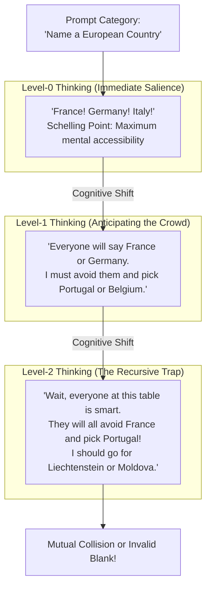
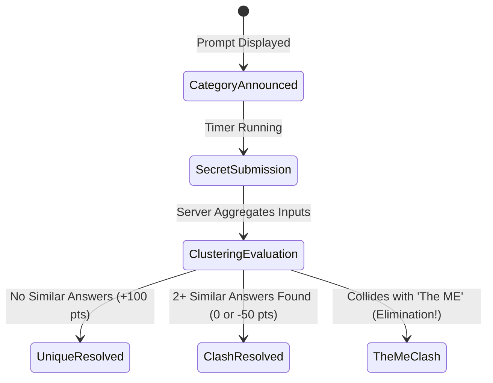
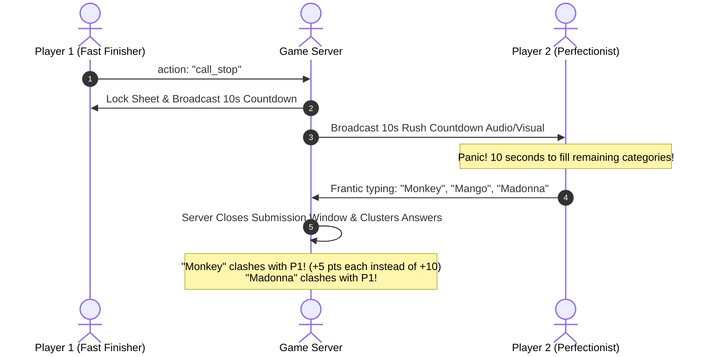
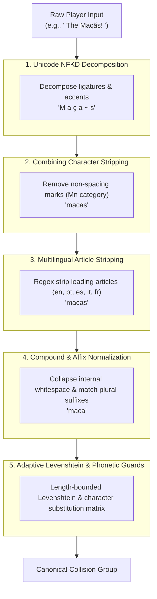
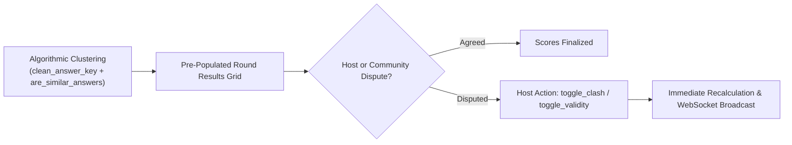

# Anti-Hivemind Game Design: Collision Penalties, Cognitive Traps, and Fuzzy Linguistic Arbitration

Traditional trivia games reward cognitive salience. In a conventional quiz, the objective is straightforward: retrieve the most famous, prominent, or historically verified fact associated with a question as rapidly as possible. If the question asks for a French capital, typing *"Paris"* is the fastest path to maximum points.

Anti-hivemind games invert this fundamental axiom. In engines like `dontsay` (*"Don't Say the Same Thing as Me"*) and `stop` (*Stop! / Tutti Frutti*), the most salient answer—what game theorists call the **Schelling point**—is not a winning move; it is a deadly trap. 

This essay examines the game theory and linguistic engineering powering the anti-hivemind engines on `marco-silva.com`: why collision penalties transform mundane categories into excruciating psychological battles, how the cognitive hierarchy traps players in recursive loops, and how distributed backend systems solve the complex algorithmic challenge of balancing linguistic strictness against fairness.

---

## 1. The Anti-Hivemind Paradox: Inverting the Schelling Point

In 1960, economist Thomas Schelling introduced the concept of the *focal point* (now known as the Schelling point): the solution that people tend to choose by default in the absence of communication, because it seems natural, prominent, or obvious to them. If you tell two strangers to meet in New York City on a specific day without communicating, they will disproportionately choose Grand Central Terminal at noon.

In anti-hivemind games, the Schelling point becomes toxic:



### The Cognitive Hierarchy in Anti-Hivemind Play

Behavioral game theorists study coordination games using **k-level cognitive hierarchy theory**:
- **Level-0 players** do not strategize about other players; they simply write the first valid item that surfaces in their associative memory (*"Apple"*, *"Dog"*, *"Paris"*).
- **Level-1 players** assume the entire room is Level-0. They deliberately avoid obvious answers and pick second-tier items (*"Pomegranate"*, *"Hedgehog"*, *"Prague"*).
- **Level-2 players** assume the room consists of Level-1 players. They predict where the Level-1 players will flee, attempting to find a third-tier sanctuary (*"Durian"*, *"Platypus"*, *"Vaduz"*).

The comedic brilliance of `dontsay` arises from the inevitable **cognitive collision**. When three players at the table simultaneously reach Level-2 thinking, they all independently decide that *"Liechtenstein"* is the clever, obscure choice. When the answers reveal simultaneously on screen, all three players clash, receiving zero points, while a Level-0 player who carelessly wrote *"Belgium"* skates through with a unique score because nobody else dared to pick it.

---

## 2. Collision Mechanics and Social Tension

The presence of a collision penalty transforms what would otherwise be a solitary typing exercise into a high-stakes psychological confrontation.

### Collision Rules in Don't Say

In `dontsay`, players receive a category prompt and secretly submit a single word before the timer expires. The scoring engine evaluates the entries:
- **Unique Valid Answer**: $+100$ points (with a $+50$ rarity bonus for obscure items evaluated by local AI).
- **Clashing Answer (Classic Mode)**: $0$ points. Both (or all) players whose answers match receive nothing for the round.
- **Clashing Answer (Harsh Mode)**: $-50$ points. Colliding actively destroys banked progress.



The harsh mode introduces genuine loss aversion. Players spend the entire 30-second submission window second-guessing their choices:
> *"Is 'Mango' too common? Everyone knows mangoes. But maybe they'll think 'Banana' is common, so mango is safe? No, Sarah loves mangoes. She's sitting across from me looking smug. She definitely wrote mango."*

### "The ME" Mode: Asymmetric Predator-Prey Dynamics

In `dontsay`'s dedicated `"The ME"` mode, the symmetric competition is replaced with an asymmetric elimination tournament:
1. One player is designated as **The ME**.
2. "The ME" secretly submits their answer first (for example, *"London"* for capital cities).
3. All other players must submit valid category answers that **do not collide with "The ME"**.
4. Anyone who collides with "The ME" is instantly eliminated (`eliminated: true`).
5. Play continues across successive rounds until only one surviving player remains.

This mode alters the cognitive task. Instead of out-thinking the collective average of the room, players must profile the individual psychology of "The ME":
- *"What is David's favorite movie?"*
- *"Does David think of obscure 1980s films, or will he panic and submit a Marvel blockbuster?"*

"The ME" acts as a live, moving minefield. Surviving players celebrate each narrow escape with audible relief, while the eliminated player experiences the theatrical sting of being "caught" by the designated hazard.

### Speed vs. Rarity in Stop! (*Tutti Frutti*)

In `stop`, the game mechanics introduce a temporal tension between speed and uniqueness. Players must fill out an entire sheet of 5 to 6 categories (e.g., *Country, Animal, Fruit, Celebrity, Brand*) with words beginning with an assigned letter (e.g., `M`).

The first player to complete their sheet hits the giant **STOP!** button. This action triggers a synchronized, immutable 10-second final countdown rush for all remaining players:



The design forces an agonizing trade-off:
- **The Fast Finisher's Dilemma**: Rushing to call STOP cuts off opponents before they can finish, but rapid-fire words tend to be the most salient Level-0 words (e.g., *Monkey*, *Mango*), increasing the likelihood of collisions.
- **The Scoring Penalty**: In `stop`, a unique valid word scores $+10$ points, but a clashing word only scores $+5$ points (or $0$ points in Zero Clash mode). A player who finishes early with 5 clashing words may score only 25 points, whereas a methodical player who filled only 3 categories with unique, obscure words (*Marmoset*, *Mangosteen*) scores 30 points.

---

## 3. The Engineering Challenge: Balancing Strictness vs. Fairness

Implementing anti-hivemind games in software introduces a profound technical obstacle: **how does a server determine whether two strings collide?**

In a board game played with pen and paper, human players effortlessly arbitrate equivalence:
- If Alice writes *"apple"* and Bob writes *"Apples"*, the table immediately agrees that these are the same answer.
- If Carlos writes *"maçã"* (with Portuguese diacritics) and Diana writes *"maca"*, the table knows they are identical.
- If Eric writes *"The Beatles"* and Fiona writes *"Beatles"*, the table considers them a clash.

However, a naive computer program evaluating `answer_a == answer_b` fails miserably. Without sophisticated linguistic normalization, players on mobile devices can evade collisions simply through accidental typos, missing diacritics, or capitalization differences. Conversely, an overly aggressive fuzzy matching algorithm might mistakenly treat two genuinely distinct short words as identical (e.g., treating *"bear"* and *"beer"* as a collision).

To solve this, the `gamerooms.prompt_engine.evaluator` module implements a deterministic multi-stage linguistic pipeline.



### Stage 1 & 2: Unicode NFKD Decomposition and Diacritic Stripping

In global party play, players frequently submit Portuguese, Spanish, French, or Italian words using diverse mobile keyboards. Some keyboards auto-insert diacritics (e.g., `ã`, `ç`, `é`, `ô`), while others omit them.

The platform uses Unicode Normalization Form KD (NFKD) and non-spacing mark category filtering:

```python
import unicodedata


def normalize_text(text: str | None) -> str:
    """Normalize text by decomposing Unicode and removing combining diacritic marks."""
    if not text:
        return ""
    decomposed = unicodedata.normalize("NFD", str(text).strip().lower())
    # Strip all characters with Unicode category 'Mn' (Mark, nonspacing)
    return "".join(ch for ch in decomposed if unicodedata.category(ch) != "Mn")
```

Under this transformation:
- `"São Paulo"` decomposes into `"S", "a", "~", "o", " ", "P", "a", "u", "l", "o"`.
- The combining tilde (`~`) is classified as `Mn` and discarded.
- Result: `"sao paulo"`.
- Both `"maçã"` and `"maca"` normalize cleanly to `"maca"`, preventing players with English keyboards from evading a collision with players using Portuguese keyboards.

### Stage 3: Multilingual Leading Article Stripping

When asked to name a band or a landmark, players casually include or omit definite and indefinite articles. In `gamerooms.prompt_engine.evaluator`, `clean_answer_key` applies a regex filter covering the supported language families:

```python
import re

# Strip leading articles across English, Portuguese, Spanish, Italian, and French
ARTICLE_PATTERN = r"^(the|a|an|o|a|os|as|um|uma|el|la|los|las|un|una|il|lo|la|le|gli|i|un'|l'|le|la|les|un|une)\s+"


def clean_answer_key(text: str) -> str:
    norm = normalize_text(text)
    return re.sub(ARTICLE_PATTERN, "", norm).strip()
```

Under this rule, `"The Beatles"` and `"Beatles"` collapse to the exact same key: `"beatles"`. Similarly, in French, `"La Tour Eiffel"` and `"Tour Eiffel"` collapse to `"tour eiffel"`.

### Stage 4 & 5: Adaptive Levenshtein Distance and Phonetic Safeguards

The most delicate engineering problem is handling **misspellings and minor typos**. If Player A types `"Raspberry"` and Player B types `"Rasberry"` (missing the silent 'p'), they have clearly chosen the same item. If the engine does not clash them, the game feels unfair.

However, applying standard Levenshtein edit distance naively introduces severe edge-case bugs:

| Word A | Word B | Edit Distance | Naive Decision | Real-World Validity |
| :--- | :--- | :--- | :--- | :--- |
| `"Rasberry"` | `"Raspberry"` | 1 | Match | **Correct**: Obvious typo collision. |
| `"Cat"` | `"Car"` | 1 | Match | **Catastrophic Error**: Distinct valid words! |
| `"Rose"` | `"Rome"` | 1 | Match | **Catastrophic Error**: Distinct flower vs city! |
| `"Bear"` | `"Beer"` | 1 | Match | **Catastrophic Error**: Animal vs Beverage! |

To balance fairness without triggering false collisions, `are_similar_answers` implements a **word-length-adaptive threshold** combined with character matrix checks:

```python
import difflib


def are_similar_answers(w1: str, w2: str) -> bool:
    if w1 == w2:
        return True

    # 1. Whitespace differences: 'mona lisa' vs 'monalisa'
    s1, s2 = w1.replace(" ", ""), w2.replace(" ", "")
    if s1 == s2:
        return True

    # 2. Plural / Singular variants
    if s1 + "s" == s2 or s2 + "s" == s1 or s1 + "es" == s2 or s2 + "es" == s1:
        return True

    min_len = min(len(s1), len(s2))

    # 3. Short Word Guard: Words of 3 letters or fewer MUST match exactly.
    # Prevents false collisions between 'cat' / 'car' / 'cow' or 'tea' / 'sea'.
    if min_len <= 3:
        return False

    dist = levenshtein(s1, s2)
    ratio = difflib.SequenceMatcher(None, s1, s2).ratio()

    # 4. 4-Letter Words: Allow edit distance 1 ONLY for known phonetic substitutions
    if min_len == 4:
        if len(s1) == len(s2):
            diff_chars = [(c1, c2) for c1, c2 in zip(s1, s2) if c1 != c2]
            if len(diff_chars) == 1:
                c1, c2 = diff_chars[0]
                # Allow minor phonetic shifts (e.g. 'c/k', 'i/y', 's/z')
                if {c1, c2} in [{"i", "y"}, {"c", "k"}, {"s", "z"}]:
                    return True
            return False
        return dist == 1 and (s1 in s2 or s2 in s1) and ratio >= 0.88

    # 5. 5-Letter Words: Edit distance <= 1 with high ratio
    if min_len == 5:
        return dist <= 1 and ratio >= 0.82

    # 6. Long Words (6+ letters): Allow edit distance up to 2 or 3
    if min_len <= 8:
        return dist <= 2 and ratio >= 0.80

    return dist <= 3 and ratio >= 0.82
```

This tiered architecture guarantees that:
- Short words ($N \le 3$) never trigger false collisions.
- 4-letter words reject distinct semantic items (`rose` vs `rome`) while accepting common phonetic variants (`mark` vs `marc`).
- Long, complex words ($N \ge 8$) forgive mobile keyboard typos (`chrysanthemum` vs `chrysenthemum`) while preserving collision fidelity.

---

## 4. The Human Arbitration Failsafe

Regardless of how sophisticated an algorithmic pipeline is, language is inherently fluid, contextual, and culturally situated. No regex or Levenshtein matrix can fully resolve whether *"Holland"* and *"The Netherlands"* should clash in a geography round, or whether *"Batman"* and *"The Dark Knight"* constitute a collision in a superhero round.

For this reason, the platform's architectural invariant is that **algorithmic evaluation serves as a suggestion, but human host arbitration is sovereign**.



In both `dontsay` and `stop`, the host dashboard provides direct toggle switches (`toggle_clash`, `toggle_validity`):
- If the algorithm missed a semantic synonym (such as *"Holland"* and *"Netherlands"*), the host taps the clash icon to merge them into a single collision group.
- If the algorithm was overly strict on a humorous pun or creative answer, the host restores the player's validity with a single click.
- Scores dynamically recompute on the server and synchronize across all client WebSockets in real time.

By combining rigorous automated normalization with immediate human arbitration, `marco-silva.com` preserves the high-velocity adrenaline of real-time play without sacrificing the nuanced fairness required for competitive party fun.
