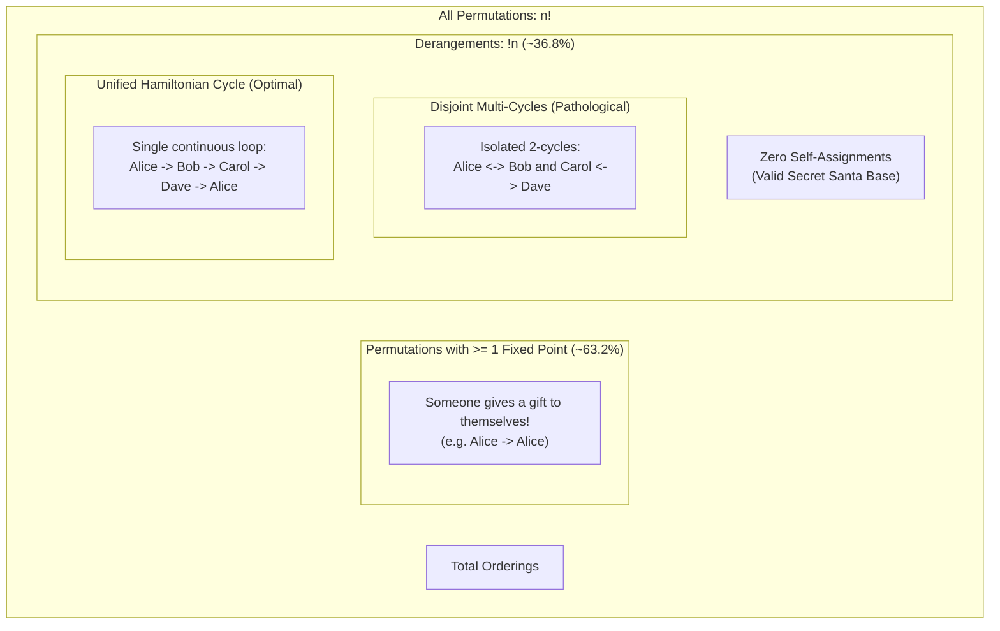
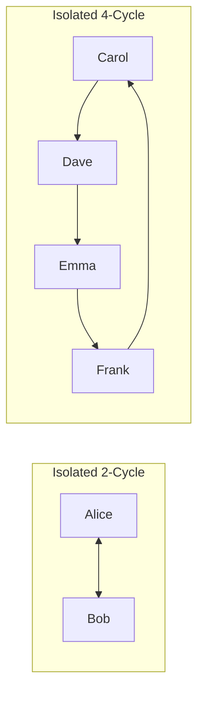
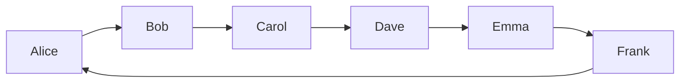
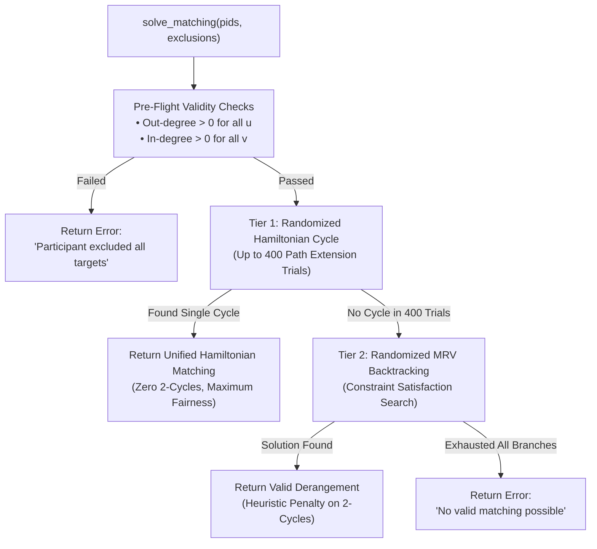

# The Combinatorics of Secret Santa: Derangements, Hamiltonian Cycles, and Constraint Satisfaction

At first glance, organizing a Secret Santa gift exchange appears to be a trivial software task: take a list of participants, shuffle their names, and pair each person with the person next to them. 

In practice, however, gift-exchange matching is an intricate combinatorial problem situated at the intersection of **permutation theory**, **directed graph cycle decomposition**, and **constraint satisfaction programming**. Naive implementations suffer from critical mathematical failure modes: participants drawing themselves, isolated two-person echo chambers, or catastrophic infinite loops when real-world exclusions (couples, roommates, siblings) are introduced.

This essay explores the mathematical architecture of the `secretsanta` engine on `marco-silva.com`: why random shuffling fails, why the presence of 2-cycles damages social cohesion, how unified directed Hamiltonian cycles guarantee superior gift exchange fairness, and how randomized Minimum Remaining Values (MRV) backtracking solves complex exclusion topologies.

---

## 1. The Mathematical Formulation: Fixed-Point-Free Permutations

Let a gift exchange consist of $N$ participants represented by the finite set:

$$P = \{p_1, p_2, \dots, p_n\}$$

A valid assignment is a bijection $f: P \to P$, where $f(p_i)$ denotes the participant to whom $p_i$ must give a gift. 

To ensure fairness, $f$ must satisfy two non-negotiable axioms:
1. **Bijectivity**: Every participant gives a gift to exactly one person, and every participant receives a gift from exactly one person.
2. **Fixed-Point Freedom**: No participant may give a gift to themselves:

$$\forall i \in \{1, \dots, n\}, \quad f(p_i) \neq p_i$$

In combinatorics, a permutation with no fixed points is known as a **derangement**. The number of derangements of an $n$-element set is denoted by the subfactorial $!n$.



### Why Naive Random Shuffling is Broken

A common software anti-pattern is the "naive shuffle":
```python
# BROKEN ANTI-PATTERN
targets = list(participants)
random.shuffle(targets)
matches = {p: t for p, t in zip(participants, targets)}
```

Using the Principle of Inclusion-Exclusion, the exact number of derangements is given by:

$$!n = n! \sum_{k=0}^n \frac{(-1)^k}{k!} = n! \left( 1 - \frac{1}{1!} + \frac{1}{2!} - \frac{1}{3!} + \dots + \frac{(-1)^n}{n!} \right)$$

Recognizing the Taylor series expansion for $e^x$ at $x = -1$:

$$e^{-1} = \sum_{k=0}^\infty \frac{(-1)^k}{k!} \approx 0.36787944117 \dots$$

As $n$ grows, the probability that a random permutation is a derangement rapidly approaches $1/e$:

$$\lim_{n \to \infty} \frac{!n}{n!} = \frac{1}{e} \approx 36.8\%$$

This means that in a naive random shuffle, approximately **63.2% of all attempts produce an invalid state** where at least one person gives a gift to themselves. 

While a simple retry loop (rejection sampling) can eventually find a derangement for unconstrained groups, rejection sampling breaks down catastrophically the moment social exclusion constraints are introduced. Furthermore, even when rejection sampling succeeds in finding a derangement, the resulting permutation often suffers from a severe sociological defect: **cycle fragmentation**.

---

## 2. Permutation Cycle Decomposition and the Pathology of 2-Cycles

By the Fundamental Theorem of Permutations, any permutation $\pi \in S_n$ can be uniquely factored into a product of disjoint directed cycles:

$$\pi = C_1 \circ C_2 \circ \dots \circ C_k$$

Where each cycle $C_j = (v_1 \to v_2 \to \dots \to v_m \to v_1)$ represents an isolated gift chain.

### The 2-Cycle Problem ($A \leftrightarrow B$)

A cycle of length 2 occurs when two participants are assigned to each other:

$$f(A) = B \quad \text{and} \quad f(B) = A$$

In combinatorial mathematics, a 2-cycle is a valid derangement. In human sociology and party design, however, **a 2-cycle is a disastrous outcome**.

Consider a group of 6 friends: Alice, Bob, Carol, Dave, Emma, and Frank. Suppose a naive derangement algorithm generates the following cycle decomposition:



During the holiday party, when gifts are opened, the failure becomes immediately apparent:
- Alice gives a gift to Bob, and Bob hands a gift right back to Alice.
- Alice and Bob form an awkward, closed bilateral bubble.
- The remaining four participants participate in a larger, collective exchange.
- Alice and Bob feel socially segregated from the group ritual, suspecting that the organizer simply paired them up out of convenience.

In a small gathering of 4 participants, the situation is even more egregious: a derangement with two 2-cycles ($A \leftrightarrow B$ and $C \leftrightarrow D$) completely destroys the illusion of Secret Santa, reducing a communal gathering to two disconnected dates.

### The Superiority of Unified Directed Hamiltonian Cycles

To maximize party cohesion, the matching engine must enforce a much stricter topological condition: the permutation must consist of **exactly one cycle of length $N$**.

In graph theory, a closed loop that visits every vertex in a directed graph exactly once is a **Hamiltonian cycle**:

$$p_1 \to p_2 \to p_3 \to \dots \to p_n \to p_1$$



A Hamiltonian cycle provides four profound social and mathematical advantages:
1. **Total Elimination of 2-Cycles**: For all $N \ge 3$, a single cycle of length $N$ contains zero 2-cycles. No two participants can ever be assigned to each other.
2. **Universal Interconnectedness**: Every participant is part of the same unified communal chain. Gift giving flows circularly through the entire group.
3. **Information Entropy**: It is impossible for any participant to deduce who bought for them simply by knowing whom they bought for (since $f^{-1}(p_i) \neq f(p_i)$).
4. **Equal Footing**: Every participant occupies an identical structural position in the directed graph.

---

## 3. Real-World Social Graphs: The Exclusion Problem

In reality, social groups are rarely unconstrained complete graphs. Participants bring complex real-world relationships that require **pairing exclusions**:
- **Couples / Spouses**: Partners who share household finances do not want to draw each other.
- **Roommates / Co-habitants**: People who live together often prefer to buy for someone outside their home.
- **Historical Repetition**: In recurring annual exchanges, participants should not draw the same person they drew last year.
- **Asymmetric Restrictions**: Participant $A$ may be restricted from drawing $B$, without $B$ necessarily being restricted from drawing $A$.

Mathematically, exclusions transform the problem from finding a Hamiltonian cycle in a complete directed graph $K_n$ into finding a directed Hamiltonian cycle (or derangement) in an arbitrary directed graph $G = (V, E)$, where:

$$V = P = \{p_1, \dots, p_n\}$$

$$E = \{ (u, v) \in P \times P \mid u \neq v \text{ and } v \notin \text{Exclusions}(u) \}$$

```mermaid
flowchart TD
    subgraph CompatibilityGraph["Directed Compatibility Graph G = (V, E)"]
        A["Alice"] -->|Allowed| C["Carol"]
        A -->|Allowed| D["Dave"]
        B["Bob"] -->|Allowed| C
        B -->|Allowed| D
        C -->|Allowed| A
        C -->|Allowed| B
        D -->|Allowed| A
        D -->|Allowed| B
        
        A -.->|FORBIDDEN (Spouse)| B
        B -.->|FORBIDDEN (Spouse)| A
    end
```

Determining whether an arbitrary directed graph contains a Hamiltonian cycle is one of Richard Karp's original **NP-complete problems**. 

Furthermore, if the graph is heavily constrained, a single Hamiltonian cycle might not exist at all, even though a valid derangement (composed of two larger cycles, e.g. length 3 and 3) is possible. The matching engine must therefore be capable of solving both regimes gracefully.

---

## 4. The Two-Tier Architecture in `secretsanta/game_state.py`

To resolve this challenge with sub-millisecond latency on production servers, the `secretsanta` engine on `marco-silva.com` implements a **hybrid two-tier solver** in `solve_matching`:



### Pre-Flight Invariant Validation

Before attempting combinatorial search, the engine executes $O(V + E)$ sanity checks:
1. **Out-degree check**: For every player $u$, $| \text{AllowedTargets}(u) | \ge 1$. If any player has excluded all remaining participants, matching is impossible.
2. **In-degree check**: For every potential recipient $v$, $|\{ u \mid v \in \text{AllowedTargets}(u) \}| \ge 1$. If nobody is permitted to give to $v$, matching is impossible.

Failing early provides descriptive, human-readable error banners to the room organizer instead of spinning in search loops.

### Tier 1: Randomized Hamiltonian Path Extension

For typical family and party groups ($4 \le N \le 30$) with moderate exclusions, finding a directed Hamiltonian cycle is fast if approached via randomized greedy path extension.

The algorithm runs up to 400 randomized trials:
1. Pick a random starting participant $p_{\text{start}}$.
2. Maintain a set of `used` vertices and an ordered `path`.
3. At each step, from the current vertex $u$, inspect unvisited valid candidates:
   $$\text{Candidates} = \{ v \in \text{valid\_targets}[u] \mid v \notin \text{used} \}$$
4. If $\text{Candidates}$ is empty, the trial has hit a dead end; abort and start a new trial.
5. Otherwise, pick $v \in \text{Candidates}$ uniformly at random, append $v$ to `path`, and mark $v$ as `used`.
6. Once all $N$ vertices are visited, verify the **closing edge**: does the last vertex in the path have a valid edge back to $p_{\text{start}}$?
   $$p_{\text{start}} \in \text{valid\_targets}[path[-1]]$$
7. If the closing edge is valid, a unified Hamiltonian cycle has been discovered! Construct the assignment:
   $$\text{matches}[path[i]] = path[i+1], \quad \text{matches}[path[-1]] = path[0]$$
   and terminate immediately.

Because this algorithm operates on random permutations, it explores different sectors of the cycle space on each run, ensuring that running the draw multiple times yields completely distinct, unpredictable assignments.

### Tier 2: Randomized Backtracking with Minimum Remaining Values (MRV)

If 400 trials of Tier 1 fail, the graph's topology is either disconnected, bipartite, or so heavily constrained by exclusions that a single Hamiltonian cycle does not exist. 

At this point, the engine gracefully transitions to Tier 2: **Constraint Satisfaction Backtracking** augmented by the **Minimum Remaining Values (MRV)** heuristic:

```python
def solve_matching(pids, exclusions, prefer_single_cycle=True):
    # ... Tier 1 executes here ...

    # Tier 2: Randomized Backtracking with MRV
    shuffled_pids = list(pids)
    random.shuffle(shuffled_pids)
    # MRV Heuristic: Order variables by smallest domain size first
    shuffled_pids.sort(key=lambda p: len(valid_targets[p]))

    assigned_targets = set()
    result_matches = {}

    def backtrack(idx: int) -> bool:
        if idx == len(shuffled_pids):
            return True
        giver = shuffled_pids[idx]
        candidates = [t for t in valid_targets[giver] if t not in assigned_targets]
        random.shuffle(candidates)

        # 2-Cycle Penalty Heuristic: Prefer targets that do not create immediate 2-cycles
        if n >= 4:
            candidates.sort(
                key=lambda c: 1 if (c in result_matches and result_matches[c] == giver) else 0
            )

        for cand in candidates:
            result_matches[giver] = cand
            assigned_targets.add(cand)
            if backtrack(idx + 1):
                return True
            assigned_targets.remove(cand)
            del result_matches[giver]
        return False
```

#### Why MRV (Fail-First Principle)?
In constraint satisfaction problems, the MRV heuristic dictates that the algorithm should assign values to the most constrained variable first (the participant with the fewest valid targets). 

If Participant $A$ can only give to Participant $B$, the algorithm assigns $A \to B$ immediately. If this assignment creates an impossible state down the line, the search fails immediately at depth 1, pruning massive exponential subtrees that a naive order would waste time exploring.

#### The 2-Cycle Penalty Heuristic
Even when falling back to general derangements in Tier 2, the engine maintains an active aversion to 2-cycles:
```python
if n >= 4:
    candidates.sort(
        key=lambda c: 1 if (c in result_matches and result_matches[c] == giver) else 0
    )
```
When choosing among valid candidates for a giver, the candidates list is sorted so that anyone who has *already* been assigned to give to this giver is placed at the very back of the candidate queue. 

Thus, the solver will only create a 2-cycle ($A \leftrightarrow B$) if the mathematical constraints of the exclusion graph strictly forbid every other configuration.

---

## 5. Algorithmic Comparison and Empirical Performance

The following matrix contrasts the mathematical and practical properties of matching strategies across party game platforms:

| Metric / Property | Naive Shuffling | Rejection Derangement | Pure Hamiltonian (Tier 1) | Hybrid Solver (`secretsanta`) |
| :--- | :--- | :--- | :--- | :--- |
| **Self-Assignment ($\pi(i) = i$)** | Highly likely (~63.2%) | Impossible (0%) | Impossible (0%) | **Impossible (0%)** |
| **2-Cycle Frequency ($N \ge 4$)** | High (~18–25%) | Moderate (~15–20%) | Strictly 0% | **0% (unless forced by exclusions)** |
| **Exclusion Graph Support** | Broken (Crashes) | Exponential freeze | Fails on disjoint graphs | **Complete ($O(1)$ to sub-millisecond)** |
| **Cycle Topology** | Highly fragmented | Multiple fragmented loops | Single unified loop | **Single loop with graceful fallback** |
| **Worst-Case Complexity** | $O(N)$ (Invalid) | $O(\infty)$ (Stall) | $O(\text{Trials} \cdot N)$ | **$O(N!)$ worst-case, pruned by MRV** |
| **Party Social Quality** | Unusable | Poor (Echo chambers) | Optimal | **Optimal** |

By unifying combinatorial derangements with directed Hamiltonian cycles and MRV constraint satisfaction, `marco-silva.com` ensures that every holiday gift exchange, office Secret Santa, or Secret Assassin game operates with guaranteed mathematical fairness, zero self-picks, and maximum communal spirit.
