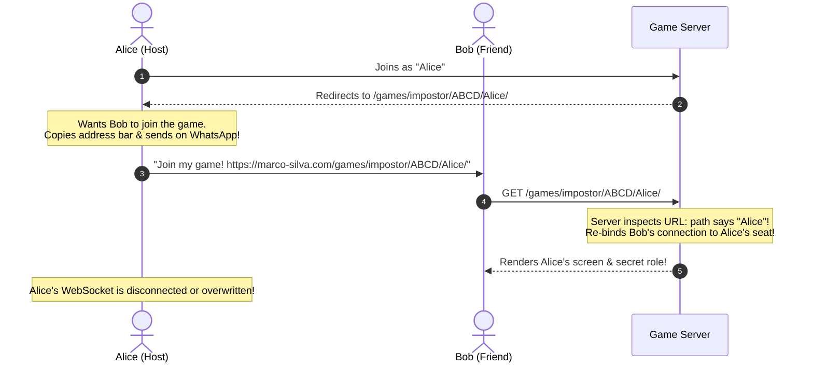
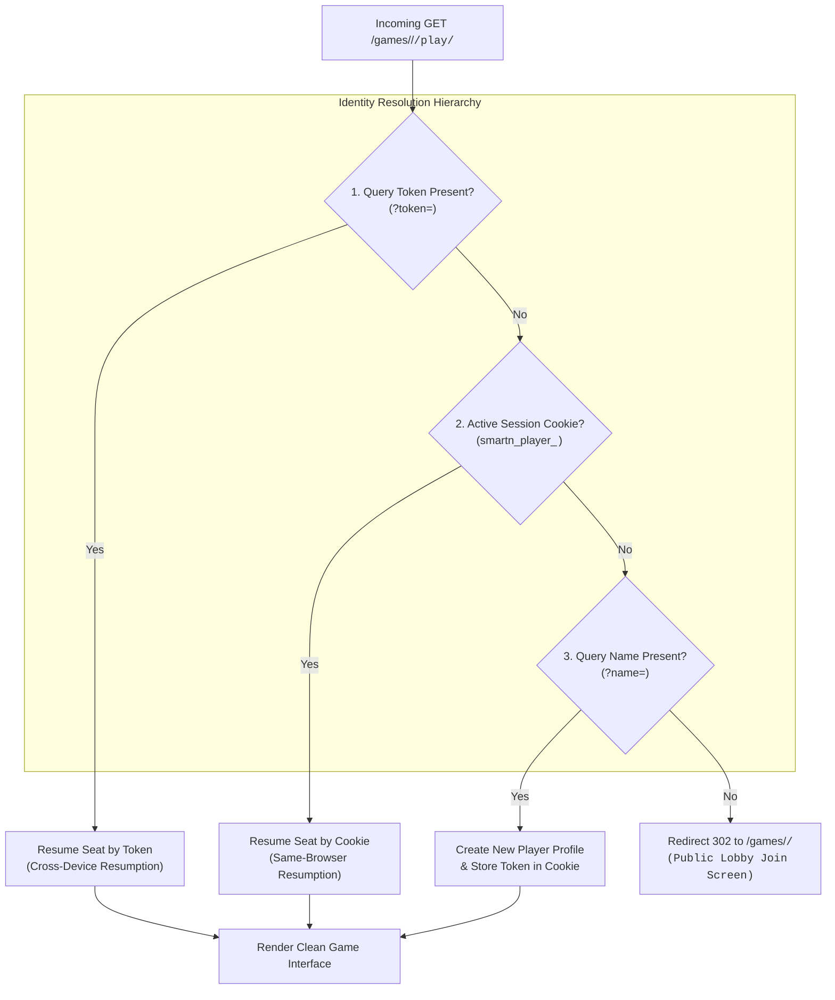
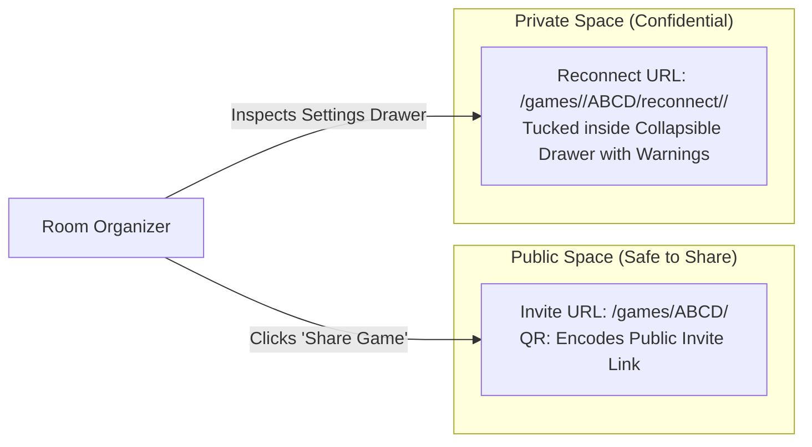
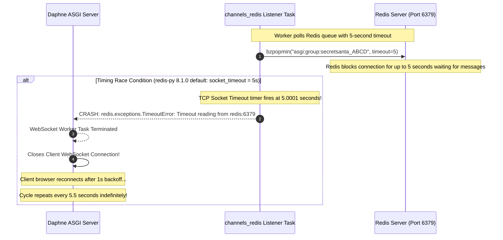
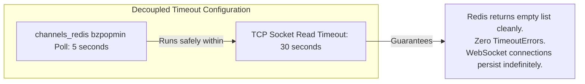

# Evolution of Party Game URL Architecture: From Path-Encoded Identity to Session-First Clean URLs and ASGI Connection Stability

Real-time web applications operate under a continuous tension between **URL expressiveness**, **session identity**, and **connection durability**. In standard content-driven websites, the URL is an address for a resource: `/articles/2026/my-post/` deterministically fetches an article. In multiplayer party games, however, the browser address bar is simultaneously a navigation target, a potential sharing mechanism, an entry point for WebSocket handshakes, and an identity anchor.

Over the evolution of `marco-silva.com`'s party game platform, early architectural assumptions regarding URL design created subtle but severe security and usability flaws—most notably the **URL-sharing seat hijacking vulnerability**. Resolving these flaws required transitioning the entire platform to a **Session-First Clean URL standard**, accompanied by strict URL segregation and resilient ASGI socket connection pooling.

This case study examines the technical evolution of party game routing across the platform: the pitfalls of path-encoded identities, the mechanics of modern session-first clean URLs, and how Daphne ASGI connection pooling was debugged to eliminate a critical 5-second Redis socket timeout loop.

---

## 1. The Flaw of Early Designs: Path-Encoded Identity

In the first two generations of the platform's party games (e.g., early versions of `emojinary`, `impostor`, `codenames`, and `stop`), room entry followed what seemed to be an intuitive RESTful pattern:
```http
GET /games/<slug>/<CODE>/<player_name>/
```
For example, when Alice entered room `ABCD` using the name *"Alice"*, her browser was redirected to:
```text
https://marco-silva.com/games/impostor/ABCD/Alice/
```

The underlying view extracted `player_name` directly from the URL kwargs, looked up or created a player named *"Alice"*, and established a WebSocket connection keyed to that URL.



### The URL-Sharing Seat Hijacking Vulnerability

In real-world party environments, the primary method users use to invite friends is **copying their mobile browser address bar** and pasting it into messaging apps (WhatsApp, Discord, iMessage) or showing a QR code on their screen.

Under the path-encoded model, this natural human behavior triggered a critical failure:
1. Alice joined as `"Alice"`. Her address bar displayed `/games/impostor/ABCD/Alice/`.
2. Alice copied the address bar and sent it to Bob.
3. Bob tapped the link on his smartphone.
4. Because the URL explicitly asserted that the client at this address was `"Alice"`, the backend treated Bob's request as an authorized resumption of Alice's seat.
5. Bob was immediately loaded into Alice's seat, gaining access to her secret words, private votes, and administrator controls.
6. When Bob's WebSocket connected, it either evicted Alice's active connection or caused two distinct physical devices to contend for the same player slot, producing erratic game state flips.

### Secondary Pathologies of Path-Encoded Routing

Beyond seat hijacking, embedding display names into URL paths introduced three additional architectural headaches:
- **Unicode and Diacritic Fragility**: Player names containing spaces, emojis, or accented characters (`"João Silva"`, `"✨Star✨"`, `"André"`) produced ugly, percent-encoded URLs (`/Jo%C3%A3o%20Silva/`). Inconsistent normalization between HTTP proxies, reverse proxies, and Django's regex URL resolvers frequently resulted in `404 Not Found` errors.
- **Stale Bookmarks**: If a player bookmarked their game link, returning to the site days later forced them into their old display name even if they joined a completely different room with the same recycled room code.
- **Leakage via Share Modals**: Early room-sharing modals generated QR codes by reading `window.location.href`. When the room organizer projected the share modal onto a TV or laptop screen, every guest who scanned the TV QR code inadvertently joined as the host!

---

## 2. Generation 3: Modern Session-First Clean URLs

To permanently eradicate seat hijacking and QR leakage, the platform underwent a comprehensive architectural refactoring (completed in releases `v173` and `v174`), standardizing all 9 party engines on the **Generation 3 Clean URL Pattern** first established in `lupus`.

Under Generation 3, the active gameplay endpoint is strictly **name-free and session-scoped**:
```http
GET /games/<slug>/<CODE>/play/
```



### The Identity Resolution Hierarchy

When a client requests `/games/<slug>/<CODE>/play/`, the view resolves the player's identity through a deterministic four-tier hierarchy:
1. **Explicit Query Token (`?token=<uuid>`)**: Used for explicit cross-device seat resumption (e.g. recovering a seat on a new phone via private reconnect links).
2. **Implicit Session Cookie (`request.session["<slug>_player_<CODE>"]`)**: Used for seamless single-browser refreshes. If the user refreshes their browser or loses cell reception, their secret token is retrieved from the encrypted session cookie without altering the clean URL.
3. **Query Parameter Name (`?name=<str>`)**: Used during initial onboarding. When a user enters their name on the public lobby screen (`/games/<CODE>/`), the lobby redirects them to `/play/?name=Alice`. The view provisions the player, writes the secret token to `request.session`, and removes the name from subsequent navigation.
4. **Fallback Redirect**: If no identity can be determined, the user is safely redirected via `302 Found` to the public room join screen (`/games/<CODE>/`).

### Segregation of Public vs. Private URLs

To prevent accidental credential leakage, Generation 3 enforces strict segregation between public invite links and private reconnect links:



In templates like `templates/secretsanta/game.html` and `templates/smartn/game.html`, the share modal renders the **true public room join link** (`/games/<CODE>/` or with embedded `?pwd=`), ensuring that anyone who copies the modal link or scans the projected screen enters as a new participant in the lobby.

The private reconnect token is housed in an expandable drawer with prominent UI warnings:
> *🔑 My Personal Reconnect Secret Link (Private to You): Bookmark this private link if you want to resume your seat later without re-entering your name. DO NOT send this link to friends!*

### Backwards Compatibility via 302 Redirections

To ensure that existing bookmarks, browser histories, and chat messages from Generation 1/2 games did not break, `gamerooms.views` implements `legacy_game_redirect`:

```python
def legacy_game_redirect(request, code: str, name: str, game_type: str):
    """302 redirect legacy /games/<game>/<CODE>/<name>/ paths to clean /play/?name=... URLs."""
    code = code.upper()
    get_object_or_404(Room, code=code, is_active=True)
    play_url = reverse(f"gamerooms:{game_type}:play", kwargs={"code": code})
    qs = request.META.get("QUERY_STRING", "")
    params = (
        f"?name={urllib.parse.quote(name)}&{qs}"
        if qs
        else f"?name={urllib.parse.quote(name)}"
    )
    return redirect(f"{play_url}{params}")
```

Any request hitting `/games/impostor/ABCD/Alice/` is immediately redirected with HTTP status 302 to `/games/impostor/ABCD/play/?name=Alice`, smoothly migrating the client into the clean-URL architecture without user intervention.

---

## 3. ASGI Connection Stability and the Redis Socket Timeout Clash

Modern party games rely on low-latency WebSockets to deliver millisecond-level responsiveness. On `marco-silva.com`, the ASGI stack consists of **Daphne 4.2.3**, **Django Channels 4.3**, **channels-redis 4.3.0**, and **redis-py 8.1.0** hosted on Debian k3s.

During the launch of the Secret Santa engine (`secretsanta`) in release `v172`, a severe networking anomaly emerged in production: **WebSocket connections entered an infinite disconnection loop, cycling every 5 to 6 seconds**.

### Anatomy of the 5-Second Disconnect Loop

To understand why the loop occurred, we must examine how `channels-redis` orchestrates message queues inside Redis.



In `channels-redis`, background consumer tasks listen for incoming group broadcasts by executing blocking sorted-set pops (`bzpopmin`) or list pops (`blpop`) with a **hardcoded 5-second polling interval**:
```python
# channels_redis internal polling loop
res = await conn.bzpopmin(channel_key, timeout=5)
```
The intention is that Redis will block for up to 5 seconds. If no message arrives, Redis returns an empty result `[]`, allowing the Python event loop to perform garbage collection, heartbeat checks, and cancelation checks before issuing the next 5-second poll.

### The `redis-py` 8.1.0 Behavioral Shift

During dependency upgrades, `redis-py` was upgraded from `5.2.1` to `8.1.0`. In `redis-py` 8.1.0, internal connection management and socket timeout enforcement underwent significant hardening.

When a connection was checked out of the connection pool, the underlying socket's timeout (`socket_timeout`) was strictly enforced on all network read calls:
- Redis server was instructed: *"Block for up to 5.0 seconds waiting for data."*
- Python TCP socket was instructed: *"If no bytes arrive within 5.0 seconds, raise `TimeoutError`."*

This created an unavoidable **microsecond race condition**:
- If Redis unblocked at 5.0000 seconds and returned the empty response, everything succeeded.
- If network latency, container scheduling, or CPU context-switching delayed the response packet by even 1 millisecond (e.g. arriving at 5.0005 seconds), the operating system socket timeout fired first!
- Python raised `redis.exceptions.TimeoutError: Timeout reading from redis:6379`.

Because this exception occurred inside the channel layer's core listener coroutine, Daphne treated it as an unrecoverable worker failure, severing the client's WebSocket connection. The browser client immediately reconnected, established a fresh socket, waited 5 seconds, and was severed again.

### The Architectural Resolution

The solution was not to eliminate Redis blocking polls, but to **decouple the TCP socket timeout from the application-level polling timeout**.

In `website/settings.py`, the `CHANNEL_LAYERS` host configuration was explicitly tuned:

```python
# website/settings.py
redis_broker_url = os.environ.get("CELERY_BROKER_URL", "redis://localhost:6379/0")

CHANNEL_LAYERS = {
    "default": {
        "BACKEND": "channels_redis.core.RedisChannelLayer",
        "CONFIG": {
            "hosts": [
                {
                    "address": redis_broker_url,
                    "socket_timeout": 30,  # 30s read timeout (6x greater than 5s bzpopmin)
                    "socket_connect_timeout": 10,  # 10s initial TCP handshake timeout
                }
            ],
        },
    },
}
```



By expanding `socket_timeout` to **30 seconds**, the TCP socket provides a generous 25-second buffer beyond the 5-second `bzpopmin` cycle. When no messages are published to a room, Redis returns its empty array cleanly at the 5-second mark; the socket never experiences an unhandled read timeout, and WebSockets maintain persistent, uninterrupted connectivity.

---

## 4. Architectural Summary

The progression from path-encoded routing to Generation 3 clean URLs and resilient ASGI connection pooling exemplifies the maturation of `marco-silva.com`'s party gaming platform:

| Dimension | Generation 1 & 2 (Legacy) | Generation 3 (Modern Production) |
| :--- | :--- | :--- |
| **Play URL Structure** | `/games/<slug>/<CODE>/<name>/` | `/games/<slug>/<CODE>/play/` |
| **Player Identity Anchor** | URL Path parameter | Encrypted Session Cookie + `?token=<uuid>` |
| **Seat Hijacking Risk** | **Critical**: Copying address bar steals seats | **Zero**: Address bar is strictly anonymous |
| **Share Link Target** | Page URL (leaked name/role) | Public Lobby `/games/<CODE>/` |
| **Reconnect Mechanism** | Re-entering exact name in URL | Cryptographic UUID via Private Reconnect Drawer |
| **Legacy URL Support** | None (breaking changes) | Automated 302 Redirection (`legacy_game_redirect`) |
| **Redis Channel Layer** | Default implicit socket timeouts | Tuned `socket_timeout: 30` (Clash-free `bzpopmin`) |
| **WebSocket Stability** | Fragile 5s disconnect loops on jitter | Rock-solid, permanent bidirectional streaming |

Through this architecture, party games achieve the ideal balance: intuitive and shareable for non-technical living room guests, seamless for returning players, and rock-solid under high-concurrency production ASGI loads.
