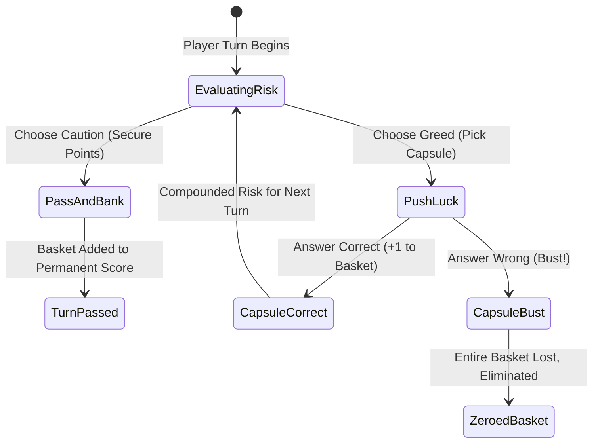
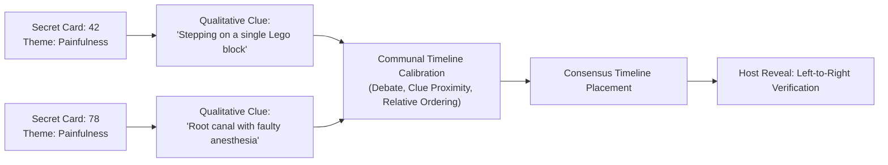
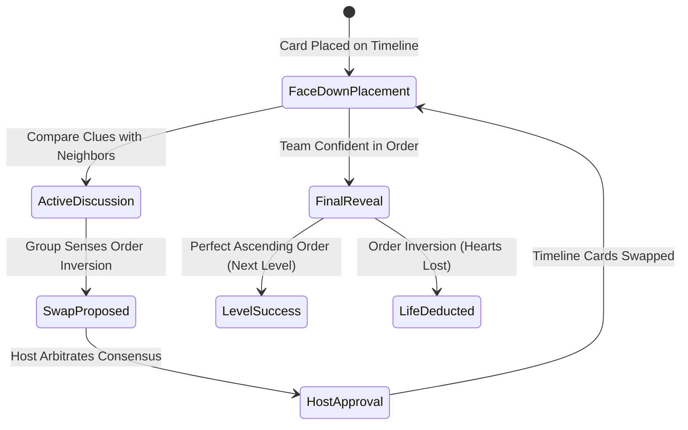
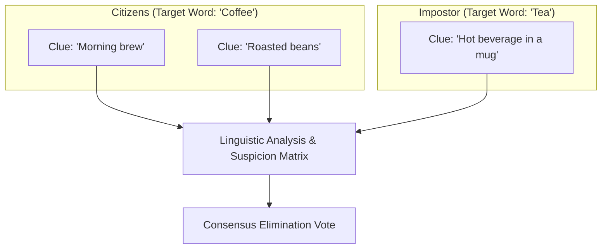
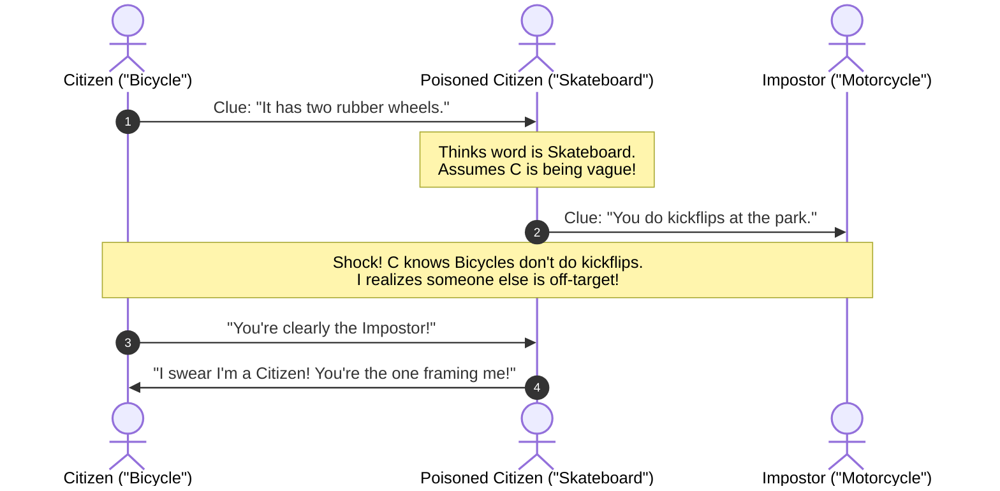
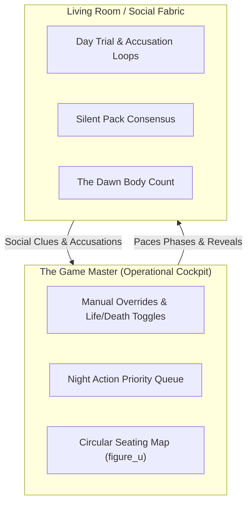
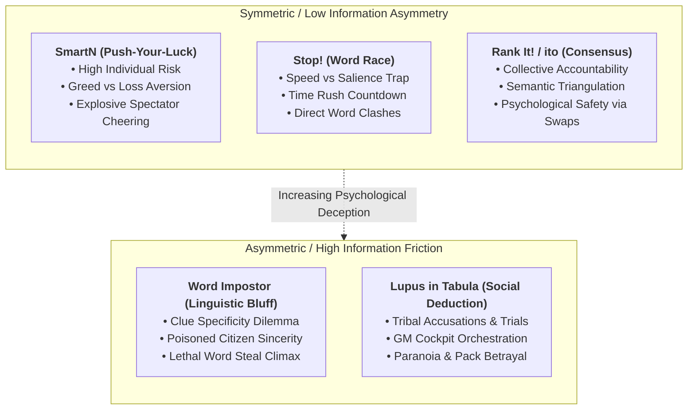

# Party Game Psychology and Group Dynamics: Risk Curves, Consensus Calibration, and Social Friction

At their core, party games are social catalysts disguised as structured rulebooks. Unlike competitive board games or solitary digital games, party games do not exist primarily to test optimization algorithms or hand-eye coordination. Instead, they operate inside what sociologist Johan Huizinga termed the *magic circle* and philosopher Bernard Suits defined as the *lusory attitude*—the voluntary attempt to overcome unnecessary obstacles in order to generate collective joy, laughter, and social connection.

In the digital living room platform of `marco-silva.com`, different party game engines manipulate different psychological and behavioral levers. By altering the flow of information, the distribution of agency, and the penalty for failure, game rules actively sculpt the emotional energy of a room. This essay examines how three fundamental mechanical paradigms—**push-your-luck tension**, **consensus calibration**, and **social deduction paranoia**—produce distinct group dynamics and psychological states.

---

## 1. Push-Your-Luck Tension and Risk Curves in SmartN

Push-your-luck mechanics transform straightforward trivia into a high-stakes psychological drama. In `smartn`, players face a card with 10 hidden capsules covering a common topic (for example, ranking historical events, identifying true statements, or picking values). Each correct capsule opened adds $+1$ point to the player's round basket. The player faces a binary decision on every turn: **Pass & Bank** their accumulated basket safely into their permanent score, or **Push Forward** to open another capsule. Opening an incorrect answer immediately busts the player: their entire round basket is forfeited to zero, and they are eliminated for the remainder of the card.

### Behavioral Economics: Loss Aversion and the Endowment Effect

The emotional intensity of `smartn` is directly governed by principles from behavioral economics, notably Amos Tversky and Daniel Kahneman's **Prospect Theory**. 

Prospect Theory demonstrates that human beings experience *loss aversion*: the psychological pain of losing a resource is quantified as roughly twice as intense as the joy of gaining that same resource. In `smartn`, when a player accumulates 3 points in their temporary basket, those points undergo the **endowment effect**—the player begins to feel psychological ownership over the points, viewing them as already "theirs" rather than as transient, unbanked numbers. 

Passing the turn feels unsatisfying because human beings are naturally drawn to streak-chasing and optimistic cognitive bias. However, pushing forward exposes the player to acute loss aversion. The table watches this internal agony in real time:

$$\text{Expected Value } E(V) = p_{\text{correct}} \cdot (B + 1) + (1 - p_{\text{correct}}) \cdot (-B)$$

Where $B$ is the current basket size, and $p_{\text{correct}}$ is the player's perceived probability of selecting a correct capsule from the remaining hidden slots.

As $B$ increases, the penalty for failure $(-B)$ grows linearly, while the incremental reward remains a constant $+1$. Mathematically, continuing to push once $B$ is large is often suboptimal; socially and psychologically, however, the momentum of the room exerts immense pressure on the player to take the risk.

### The Social Dynamics of the Greedy Streak vs. Cautious Banking

In a physical room or voice call, `smartn` divides players into distinct behavioral archetypes:
- **The Cautious Banker**: Opens one reliable capsule, banks immediately, and collects steady, low-variance points. While strategically sound, this player often receives playful teasing from peers for lack of courage.
- **The Gambler / Streak Chaser**: Driven by adrenaline and peer validation, this player attempts to clear 4, 5, or 6 capsules in a single turn.

The dynamic between these archetypes creates high spectator engagement. When a player pushes forward on their fourth capsule, the spectators are not passive observers; they become a Greek chorus cheering on reckless greed or gasping when a 50/50 guess results in a catastrophic bust. The bust does not generate genuine anger; rather, it produces communal relief and schadenfreude, releasing the accumulated tension with laughter.

### Couch Pass & Play as a Tactile Ritual

The architecture of `smartn` includes an offline single-device mode (`is_couch: true`). In couch mode, rather than requiring every participant to connect on an individual phone, a single device is physically passed from lap to lap.

This physical transition alters the group psychology. Holding the physical screen acts as an **anchor of accountability**. The entire room's gaze focuses on the hands of the active player. The tactile act of tapping a capsule on a shared screen, accompanied by instant CSS flip animations and audio cues, creates a shared living room ritual reminiscent of traditional physical board games.

---

## 2. Consensus Calibration and Collective Intuition in Rank It! (*ito*)

While `smartn` leverages individual risk-taking, `rankit` (based on the Japanese game *ito*) operates on **cooperative calibration**. In `rankit`, every player secretly receives numbered cards from 1 to 100 without duplicates. The group is presented with a subjective spectrum prompt (for example: *"1 = Least painful thing, 100 = Most painful thing"* or *"1 = Weakest fictional superpower, 100 = God-tier superpower"*).

Players must place all their cards onto a central communal Timeline in perceived ascending order. Crucially, players are strictly forbidden from uttering numbers, percentages, or mathematical metaphors. They can only communicate through creative analogies, narrative explanations, and comparative debate.

### The Inherent Friction of Subjective Spectrums

The fundamental game-design insight of *ito* is that **no two human beings share identical mental models of qualitative concepts**. 

What constitutes a "50 out of 100" in scary movies? To a horror film aficionado, a classic ghost story is a 20; to someone who dislikes jumpscares, that same movie is an 80. The game transforms this communicative misalignment into a puzzle of empathy and semantic calibration.

When Player A gives the clue *"A lukewarm cup of black coffee"* for their card, and Player B gives the clue *"Stale tap water on a summer afternoon"*, the group must engage in semantic triangulation:
1. Which experience is objectively more disappointing?
2. How exaggerated was Player A's tone of voice?
3. What do we know about Player B's personal tolerance for bad beverages?

Through this dialogue, the game forces players to construct a temporary, shared micro-culture. Players do not just evaluate the clues; they evaluate each other's personalities, past experiences, and cognitive quirks.

### The Psychological Safety of the Swap Consensus Engine

In many cooperative games, players experience anxiety regarding making mistakes that harm the team (the "alpha gamer" or "blame culture" problem). `rankit` solves this by introducing a face-down communal timeline and a structured swap proposal mechanism (`propose_swap`, `approve_swap`).

Cards are played face-down. Even after a player commits a card to a slot, the decision is not final. Any player can propose swapping two adjacent cards if subsequent discussion reveals that their clues were improperly ordered. 

This design creates **psychological safety**:
- Committing a card is low-friction because placements are provisional hypotheses rather than irreversible errors.
- The responsibility for card order shifts from the individual cardholder to the collective consensus of the room.
- When the timeline reveals a descending card and the team loses a life heart, the failure is shared: *"We all agreed to swap those two cards!"*

The progressive level scaling (Level 1: 1 card each, Level 2: 2 cards each, Level 3: 3 cards each) introduces cognitive load exponentially. In Level 3, a room of 5 players must coordinate 15 distinct semantic clues along a single 1–100 continuum, turning the discussion into a rich tapestry of lively philosophical debate.

---

## 3. Social Deduction Friction and Paranoia in Word Impostor and Lupus

Social deduction games rely on asymmetric information to produce interpersonal friction, cognitive dissonance, and social paranoia. On `marco-silva.com`, two engines explore this space: `impostor` (*Word Impostor / Undercover*) and `lupus` (*Lupus in Tabula / Werewolf*).

### Linguistic Bluffs and the Asymmetric Information Gap in Word Impostor

In `impostor`, the majority of players receive a common Citizen Word (e.g., *"Coffee"*), while one or two players receive a closely related Impostor Word (e.g., *"Tea"*). In early rounds, nobody knows who holds which word—not even the impostors themselves, who initially believe they are regular citizens holding the majority word.

The psychology of clue-giving in `impostor` is governed by a delicate balancing act:
- **The Specificity Dilemma**: If a Citizen gives a clue that is too specific (*"Espresso grind size"*), they prove their innocence to fellow Citizens, but they hand the secret word directly to the Impostor on a silver platter.
- **The Generality Trap**: If a Citizen gives a clue that is too vague (*"It's liquid and warm"*), they protect the word from the Impostor, but their vagueness immediately triggers suspicion from other Citizens, who accuse them of being an Impostor bluffing without knowledge.

The Impostor experiences intense cognitive dissonance. The moment they hear clues that sound slightly off (*"Roasted beans?" "Wait, do people roast tea leaves?"*), their mental state shifts from relaxed participation to acute, defensive hyper-vigilance. They must camouflage their clues to blend seamlessly into both semantic domains.

### The Poisoned Citizen ("The Drunk"): Subverting the Binary Model

The most sociologically fascinating innovation in `impostor` is the **Poisoned Citizen** mode (historically known in tabletop circles as "The Drunk").

In standard social deduction, players inhabit binary categories:
1. Honest players with true information (Citizens / Villagers).
2. Deceivers with false information or hidden malice (Impostors / Werewolves).

The Poisoned Citizen completely fractures this epistemological foundation. The Poisoned Citizen is a loyal member of the Citizen team, but the engine secretly assigns them an unannounced third word from the same semantic cluster (e.g., Citizens receive *"Bicycle"*, Impostor receives *"Motorcycle"*, and Poisoned Citizen receives *"Skateboard"*).

The Poisoned Citizen does not know they are poisoned. When they give their clue, they do so with 100% genuine sincerity and moral righteousness. When other players accuse them of lying, the Poisoned Citizen defends themselves with authentic indignation. 

This generates unparalleled comedic paranoia. The table witnesses an honest player passionately arguing for their innocence while providing evidence that seems undeniably fraudulent. The game mechanics turn the group's natural truth-detection heuristics (eye contact, conviction, lack of hesitation) against them.

### The Lethal Word Steal: The Counterweight to Early Discovery

In many social deduction games, once an impostor is discovered, the game abruptly ends in anti-climax. In `impostor`, the **Lethal Word Steal** mechanic alters the endgame incentive structure:

> If the room votes to eliminate the Impostor, the Impostor is not immediately defeated. Instead, they are presented with a final input screen: they may guess the Citizen Word. If their guess matches, the Impostor steals victory from the jaws of defeat.

This mechanism alters the behavior of the Citizens throughout the entire round:
- Citizens cannot simply "pile on" clues that explicitly name the category.
- When unmasking the Impostor during debate, Citizens must avoid giving away the exact noun during their accusations.
- Even when caught, the Impostor remains an active, listening agent, feverishly parsing every spoken syllable for the final lexical deduction.

### Sociological Hierarchy and the GM Cockpit in Lupus in Tabula

In `lupus` (*Werewolf / Mafia*), the social dynamics scale up to large groups (8 to 25+ players). The structural core of this engine is the role of the **Game Master (GM)**.

The GM is not a participant in the competition; the GM is the **dramaturge**. Using the real-time GM Cockpit, the host orchestrates the emotional cadence of the room:
- **Night Phase**: Silence descends. The room's auditory environment becomes hypersensitive; the rustle of a jacket or the faint glow of a phone screen can lead to an accusation of werewolf activity.
- **Dawn Report**: The GM reveals who perished during the night. The dawn report resets the social hierarchy, eliminating charismatic leaders or protecting vulnerable novices.
- **Day Accusation & Lynch Trials**: The room transitions into a tribal courtroom. Without hard physical evidence, voting patterns become mirrors of social influence, persuasive rhetoric, and herd behavior.

The circular seating visualizer (`figure_u`) reinforces the ancient human tradition of the council fire: every player can make direct eye contact with every other player, ensuring that facial micro-expressions and postural shifts remain primary vectors of gameplay.

---

## 4. Mechanical Synthesis: The Tripartite Model of Party Game Energy

By observing players across hundreds of rounds, we can map party game mechanics onto a comparative spectrum of group energy and social tension:

| Game Mechanic | Primary Psychological Driver | Failure Mode / Penalty | Social Group Energy |
| :--- | :--- | :--- | :--- |
| **Push-Your-Luck** (`smartn`) | Greed vs. loss aversion; optimistic bias; gambler's momentum | Personal bust; total basket loss; elimination from current card | High-voltage spectator cheering; explosive bursts of collective laughter |
| **Consensus Calibration** (`rankit`) | Empathetic alignment; semantic triangulation; collective intuition | Team heart loss; shared group failure | Deep, conversational, collaborative debate; shared relief upon success |
| **Linguistic Deduction** (`impostor`) | Information asymmetry; camouflage; truth-detection heuristics | Unmasking / execution; lethal word steal flip | Hyper-vigilant listening; sudden comedic revelations; intense paranoia |
| **Tribal Social Deduction** (`lupus`) | Mob psychology; rhetorical persuasion; political coalition-building | Night assassination; public execution at the stake | Theatrical tribalism; high-stakes drama; alternating silence and uproar |

Understanding these psychological dynamics enables room hosts and game designers to deliberately curate the trajectory of a social gathering: beginning with the low-friction collaborative warmth of `rankit`, accelerating through the thrilling risk curves of `smartn`, and culminating in the dramatic accusations and theatrical betrayals of `impostor` and `lupus`.
