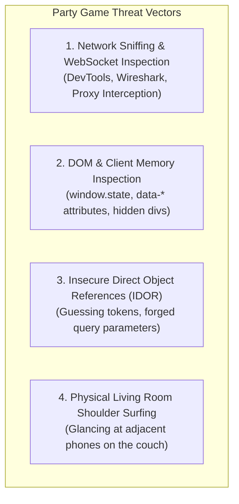
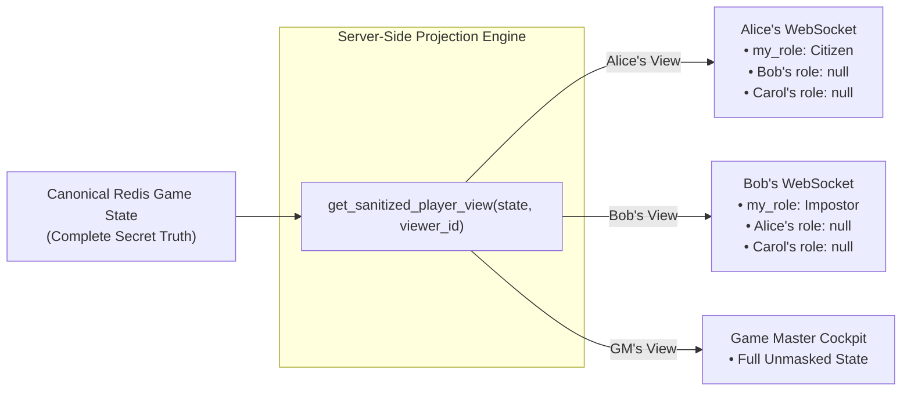
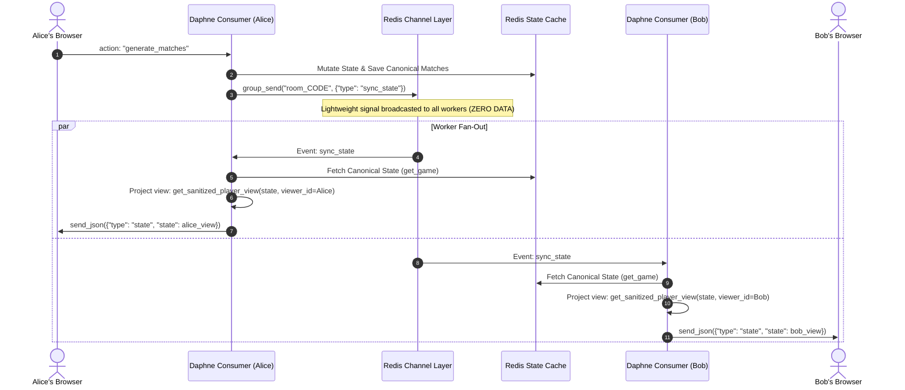
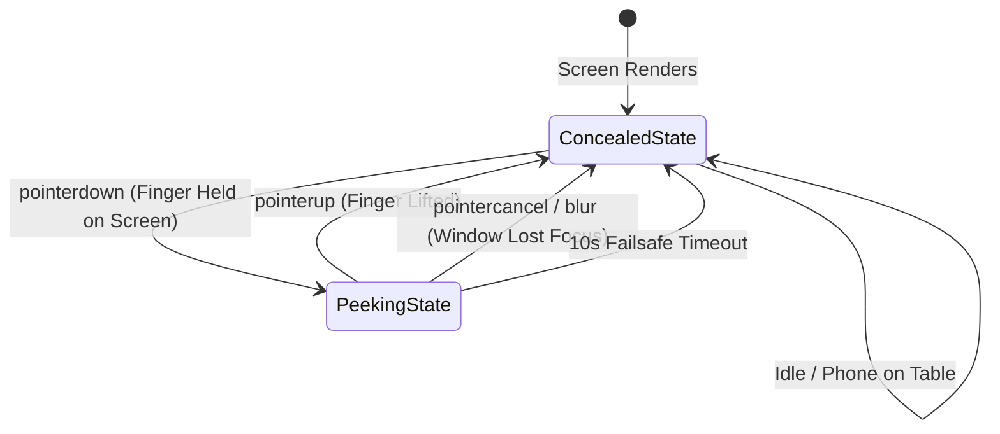

# Zero-Spoiler Security Architecture: State Projections and Cryptographic Isolation in Real-Time WebSockets

In web development, real-time multiplayer applications are frequently built around a naive broadcast model: when room state changes, the server serializes the entire state document into a JSON blob and broadcasts it across a WebSocket group to all connected clients. Client-side frameworks (React, Vue, or vanilla JavaScript) then filter the view, hiding elements using `v-if`, `display: none`, or template conditionals.

In party games, **this naive architecture is a catastrophic vulnerability**.

Whether playing social deduction games like `impostor` (*Undercover*) and `lupus` (*Werewolf*), hidden-information spectrum games like `rankit` (*ito*), push-your-luck trivia like `smartn`, or gift exchanges like `secretsanta`, the entire ludic premise hinges on **strict information asymmetry**. If a tech-savvy player opens Chrome DevTools, inspects the WebSocket frames, or evaluates `window.state` in the console, a broadcast-all architecture instantly betrays the entire game: secret words are exposed, hidden roles are uncovered, and gift targets are spoiled.

This essay explores the **Zero-Spoiler Security Architecture** designed for `marco-silva.com`: the mathematical and operational invariants governing secret state, the distributed "Signal-and-Project" pattern across Daphne and Django Channels, and how defense-in-depth spans from server-side projection down to physical touch curtains.

---

## 1. The Threat Model of Real-Time Party Games

Securing a party game presents unique threat vectors that do not exist in conventional web applications or enterprise software.



### The "Inspect Element" Vulnerability

The most pervasive vulnerability in indie web games is treating client-side JavaScript as a security perimeter. Consider an Impostor game where the server broadcasts:
```json
// DANGEROUS ANTI-PATTERN: Client-Side Masking
{
  "players": [
    {"name": "Alice", "role": "citizen", "word": "Coffee"},
    {"name": "Bob", "role": "impostor", "word": "Tea"}
  ]
}
```
If the frontend attempts to hide Bob's role with:
```html
<div class="role" style="display: none;">Impostor: Tea</div>
```
Bob's identity is completely compromised before the first clue is ever spoken. Any player can open DevTools, inspect the DOM tree, or check the Network WS frames to trivially discover the Impostor.

### The Shoulder-Surfing Threat

Unlike online games where players sit in separate homes, party games are physically co-located in living rooms, pubs, or offices. Participants sit elbow-to-elbow on sofas. A notification banner, a momentary screen tilt, or a persistent secret card on an idle phone will leak secret state to adjacent players. Security must therefore address physical optics alongside cryptographic networking.

---

## 2. The Zero-Spoiler Projection Invariant

To eliminate these vulnerabilities, `marco-silva.com` enforces a universal architectural law across all 9 party game engines:

> **The Zero-Spoiler Projection Invariant**:
> At no point during an active match shall secret state (roles, unrevealed answers, secret words, unplaced card values, or target IDs) leave server memory towards an unauthorized client socket before the designated game phase transition.
>
> If a player inspects the WebSocket connection, the raw network payload must contain `null` or `None` for all secret fields.



Under this model, the client browser is treated as an **untrusted rendering terminal**. The client does not possess the secret data; therefore, no amount of client-side reverse engineering, memory scanning, or script injection can extract information that the server never sent.

---

## 3. The "Signal-and-Project" Pattern in Django Channels and Daphne

Implementing personalized, zero-spoiler views in a distributed real-time environment introduces a fundamental conflict with standard pub/sub broadcasting.

### The Broadcast Paradox

In Django Channels, real-time synchronization is traditionally accomplished via `channel_layer.group_send()`:
1. An action occurs (e.g., a card is drawn).
2. The consumer serializes the updated state.
3. The consumer sends `group_send("room_ABCD", {"type": "chat_message", "state": state})`.
4. The Redis channel layer duplicates and broadcasts that identical payload to every connected worker.

This model fundamentally fails when 10 players have 10 distinct secret perspectives! You cannot broadcast a single payload if Alice must see target $X$, Bob must see target $Y$, and Carol must see target $Z$.

### The Architectural Solution: Empty Signal Fan-Out

To resolve this paradox, the platform implements the **Signal-and-Project Pattern**. Instead of broadcasting game data through the channel layer, the channel layer is used solely as an **empty synchronization signal**:



The lifecycle proceeds in five deterministic steps:
1. **Lightweight Notification**: The triggering consumer sends a parameterless event:
   ```python
   await self.channel_layer.group_send(
       self.group_name,
       {"type": "sync_state"},
   )
   ```
2. **Independent Consumer Wakeup**: Daphne receives the `sync_state` event across all active consumer instances attached to that room group.
3. **State Fetch**: Each consumer retrieves the authoritative, unmasked game state from the shared Redis cache (`get_game(self.code)`).
4. **Personalized Projection**: Each consumer calls `get_sanitized_player_view(state, viewer_id=self.player_id)`. The function evaluates the caller's identity against the phase rules, stripping every secret that does not belong to `self.player_id`.
5. **Unicast Delivery**: Each consumer serializes its bespoke, sanitized dictionary and transmits it down its dedicated client WebSocket (`self.send_json`).

This architecture decouples synchronization from authorization. The Redis channel layer remains blazingly fast because it routes tiny event signals rather than megabytes of state payloads, while each ASGI worker independently projects an unforgeable view.

---

## 4. Cross-Game Projection Implementations

Every party game engine in the platform tailors `get_sanitized_player_view` to its specific game mechanics:

### 1. Secret Santa (`secretsanta`)
In `secretsanta/game_state.py`, the global matching dictionary `state["matches"]` mapping givers to receivers is strictly server-internal:
```python
def get_sanitized_player_view(
    state: dict[str, Any], viewer_id: str | None = None
) -> dict[str, Any]:
    # ... general metadata ...

    # Public player roster: targets completely absent
    view["players"] = [
        {
            "id": p["id"],
            "name": p["name"],
            "color": p["color"],
            "has_wishlist": bool(p.get("wishlist")),
        }
        for p in state["players"].values()
    ]

    # Only the viewer's target is revealed, and ONLY during 'matched' phase
    if state.get("phase") == "matched" and viewer and viewer.get("target_id"):
        target = state["players"].get(viewer["target_id"])
        view["my_target"] = {
            "name": target["name"],
            "color": target.get("color"),
            "wishlist": target.get("wishlist", ""),
        }
    else:
        view["my_target"] = None
```
Even if an attacker intercepts the entire JSON payload sent to Alice, Bob's target is not masked with stars or hidden behind a boolean; it is entirely nonexistent in the response.

### 2. SmartN Push-Your-Luck Trivia (`smartn`)
In `smartn`, a question card contains 10 hidden capsules (`smartn/game_state.py`). During active play, unrevealed capsules must not betray whether they are correct or wrong:
```python
for item in card["items"]:
    slot = item["slot"]
    if slot in revealed_capsules or phase in ("round_summary", "gameover"):
        # Safe to reveal: capsule was tapped or round ended
        sanitized_items.append(item)
    else:
        # Strictly mask unrevealed capsule
        sanitized_items.append(
            {
                "slot": slot,
                "label": item.get("label", ""),  # Category clue visible
                "value": None,  # MASKED
                "is_correct": None,  # MASKED
                "explanation": None,  # MASKED
                "guessed_value": None,  # MASKED
            }
        )
```
A player attempting to inspect the browser DOM or network responses to see which capsule holds the correct trivia answer receives only `null`.

### 3. Rank It! / *ito* (`rankit`)
In `rankit/game_state.py`, players communicate qualitative analogies for numbers between 1 and 100. Cards placed on the communal timeline remain face-down until the team triggers the final reveal:
```python
# In get_sanitized_player_view:
for card in state["timeline"]:
    if not state.get("timeline_revealed") and phase not in ("gameover", "victory"):
        card_copy["number"] = None  # MASKED on timeline until reveal
```
Furthermore, the cards in other players' hands are stripped of their numerical values: Alice can see that Bob holds 2 cards and has set the clue *"Stale bread"*, but `card["number"]` is `None`.

### 4. Word Impostor (`impostor`)
In `impostor/game_state.py`, the secret words must remain strictly isolated:
```python
for pid, p in state["players"].items():
    if pid == viewer_id:
        view["my_card"] = {
            "role": p.get("role"),
            "word": p.get("word"),
        }
    else:
        # Opponent identities masked
        view["players"].append(
            {
                "id": pid,
                "name": p["name"],
                "role": None,  # MASKED
                "has_submitted_clue": bool(p.get("clue")),
            }
        )
```

---

## 5. Physical Privacy: "Tap and Hold to Peek" Tactile Shields

Server-side projection guarantees that data does not leak over the wire. However, in a living room party, **physical shoulder surfing** remains an acute vulnerability.

To neutralize this threat, `marco-silva.com` implements the **Tactile Privacy Curtain** across sensitive views (Secret Santa targets, Impostor roles, and Werewolf night cards):



### The Continuous Touch Contract

A traditional "Click to Reveal" button is dangerous: a player clicks the button, gets distracted by a conversation, and leaves their secret target illuminated on the screen for the entire room to see.

The **Tap-and-Hold Shield** enforces a continuous physical gesture:
1. **Opaque Physical Cover**: The secret card renders with an opaque backdrop, displaying a fingerprint icon and the instruction *"Press & Hold to Peek"*.
2. **`pointerdown` Activation**: When the user presses their thumb onto the shield, CSS classes toggle: the curtain fades out, and the secret role/target becomes visible.
3. **Instant Snap-Shut on Release**: The moment the thumb leaves the glass (`pointerup`, `touchend`), the curtain instantly snaps shut with zero transition latency.
4. **Boundary Failsafes**: If the user drags their finger off the screen (`pointercancel`), switches apps (`window.blur`), or holds the finger down continuously for more than 10 seconds, an automated failsafe snaps the curtain shut.

```javascript
// Tactile Privacy Curtain Implementation
const shield = document.getElementById('privacy-shield');
const cardContent = document.getElementById('secret-content');

function conceal() {
  shield.classList.remove('peek-active');
  cardContent.classList.add('blurred');
}

function reveal() {
  shield.classList.add('peek-active');
  cardContent.classList.remove('blurred');
}

shield.addEventListener('pointerdown', (e) => {
  e.preventDefault();
  reveal();
});

['pointerup', 'pointercancel', 'pointerleave'].forEach((evt) => {
  shield.addEventListener(evt, conceal);
});
window.addEventListener('blur', conceal);
```

By coupling **server-side view projection** over WebSockets with **tactile continuous-touch curtains** in the browser, `marco-silva.com` achieves comprehensive defense-in-depth: secret state is protected against network packet sniffing, client-side DOM inspection, and casual living room glances alike.
