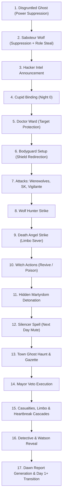

# Reference: Lupus in Tabula Role Catalogue and Interaction Matrix

This document provides the authoritative technical reference for all 29 roles in the `lupus` engine (`lupus/roles.py` and `lupus/game_state.py`). It specifies team allegiances, aura checks, night action execution order, targeting constraints, victory conditions, and cross-role interaction behaviors.

---

## 1. Master Role Registry Table

| Role Identifier | Display Name (Werewolf / Mafia) | Faction Team | Detective Aura | Night Priority (1–19) | Action Target | Primary Ability / Mechanic | Win Condition |
| :--- | :--- | :--- | :--- | :--- | :--- | :--- | :--- |
| `villager` | Villager / Citizen | **Town** | Good | None | None | Deductive daytime vote | Town Victory |
| `werewolf` | Werewolf / Mafioso | **Wolves** | Evil | Stage 6 | 1 living player | Nightly pack kill consensus | Wolves Parity / Majority |
| `alpha_wolf` | Alpha Wolf / Godfather | **Wolves** | **Good (Innocent)** | Stage 6 | Pack kill target | Immune to Detective detection; leads pack | Wolves Parity / Majority |
| `silencer` | Silencer / Consigliere | **Wolves** | Evil | Stage 7 | 1 player ($\ne \text{yesterday}$) | Mutes target for daytime discussion (target retains vote) | Wolves Parity / Majority |
| `framer` | Framer / Corrupter | **Wolves** | Evil | Stage 7b | 1 innocent player | Causes target to appear "Evil" to Detective tonight | Wolves Parity / Majority |
| `wolf_cub` | Wolf Cub / Mob Junior | **Wolves** | Evil | Stage 6 | Pack kill target | If slain, triggers 2 pack kills next night (Rampage) | Wolves Parity / Majority |
| `detective` | Detective / Seer | **Town** | Good | Stage 8 | 1 living player | Inspects alignment (Good vs Evil) | Town Victory |
| `doctor` | Doctor / Medic | **Town** | Good | Stage 9 | 1 living player | Protects target from werewolf night kill | Town Victory |
| `bodyguard` | Bodyguard / Protector | **Town** | Good | Stage 10 | 1 other living player | Shields target by dying in their place if attacked | Town Victory |
| `witch` | Witch / Chemist | **Town** | Good | Stage 11 | 1 Limbo/Wolf victim, 1 Living | 1 Revival Potion (heals Limbo/wolf hit) + 1 Poison Potion | Town Victory |
| `sniper` | Vigilante / Sniper | **Town** | Good | Stage 12 | 1 living player | Danger bullet kills evil (backfires on innocent); Silver is safe | Town Victory |
| `serial_killer` | Serial Killer / Hitman | **Neutral** | Evil | Stage 13 | 1 living player | Kills 1 player nightly; immune to wolves | Sole Survivor or Wolves Vanquished |
| `wolf_hunter` | Wolf Hunter / Van Helsing | **Neutral** | Good | Stage 14 | 1 living player | Kills werewolf; backfires and kills hunter if target innocent | Town Victory |
| `death_angel` | Death Angel / Reaper | **Neutral** | Good | Stage 15 | 1 soul in Limbo | Permanently severs soul in Limbo (1 strike per game) | Town Victory |
| `ghost` | Town Ghost / Spirit | **Town** | Good | Stage 16 | 1 living player | Haunts target; posts spectral message to Gazette | Town Victory |
| `martyrdom` | Martyrdom / Kamikaze | **Town** | Good | Stage 17 | 1 living player (or Day killer) | Detonates booby trap upon death to eliminate killer/target | Town Victory |
| `mayor` | Mayor / Magistrate | **Town** | Good | Stage 18 | Lynched player | Double vote weight (2); 1 executive veto per game | Town Victory |
| `disgruntled_ghost` | Disgruntled Ghost | **Neutral** | Evil | Stage 1 | 1 living player | Suppresses target's night powers before they act | Threat / Neutral Victory |
| `saboteur_wolf` | Saboteur Wolf | **Wolves** | Evil | Stage 5 | 1 living player | 1-time power suppression + role steal | Wolves Parity / Majority |
| `hacker` | Hacker / Informant | **Town** | Good | Stage 4b | 2–3 players (Night 0) | Scans group: Clean, Minority, Split, Majority, All Evil | Town Victory |
| `watson` | Watson / Deputy | **Town** | Good | Stage 3b | Detective (Night 0) | Learns identity of the Detective on Night 0 | Town Victory |
| `cupid` | Cupid / Matchmaker | **Neutral** | Good | Stage 4 | 2 players (Night 0) | Binds 2 players as Obsessive Lovers | Town Victory / Lovers |
| `lover` | Innocent Lover | **Town** | Good | Stage 3 | Partner (Night 0) | Paired lover; dies of heartbreak if partner dies | Town Victory |
| `obsessive_lover` | Obsessive Lover | **Neutral** | Ambiguous | None | Partner | Bound by Cupid; dies of heartbreak if partner falls | Last 2 Survivors Alive |
| `jester` | Jester / Fool | **Neutral** | Good | None | None | Wins immediately if executed at daytime trial | Lynched at Day Trial |
| `angel` | Angel / Guardian Spirit | **Town** | Good | Stage 18b | Limbo guessers | While alive, night victims enter Limbo to guess Angel | Town Victory |
| `gull` | The Gull / Innocent Bitten | **Town $\to$ Wolves** | Good $\to$ Evil | None | None | If bitten by wolves and unprotected, converts to Werewolf | Town (initial) / Wolves (converted) |
| `traveler` | Traveler / Nomad | **Town** | Good | None | None | Passive shield: immune to first night attack | Town Victory |
| `successor` | Successor / Heir | **Neutral** | Ambiguous | None | Fallen predecessor | Steps in upon partner death to inherit mantle and save lover | Inherited Role Victory |

---

## 2. Night Action Priority Order (Execution Stages 1–19)

During `resolve_night(state)`, night stages execute in strict canonical order:

### Stage Details

1. **Stage 1 — Disgruntled Ghost**: `disgruntled_ghost_target` added to `suppressed_pids`. Target cannot execute any night action tonight.
2. **Stage 2 — Saboteur Wolf**: `saboteur_target` suppressed and role uncovered to the wolf pack (1-time use).
3. **Stage 3 — Hacker Intel**: Hacker group scan computed on Night 0 and announced at Dawn. Day 1 voting blocked.
4. **Stage 4 — Cupid Binding**: Binds two players as `obsessive` lovers on Night 0.
5. **Stage 5 — Doctor Protect**: `doctor_protect` added to `to_save`. Prevents werewolf kill.
6. **Stage 6 — Bodyguard Setup**: `bodyguard_protect` active if Bodyguard is alive and unsuppressed.
7. **Stage 7 — Lethal Strikes**:
   - `wolf_target` + `wolf_target_2` (if Rampage active from slain Wolf Cub).
   - `sk_target` (Serial Killer strike).
   - `sniper_shot` (Vigilante shot): Danger bullet kills evil, backfires on innocent; Silver bullet is safe.
   - Bodyguard Interception: If target of Wolf, SK, or Vigilante is shielded by Bodyguard, target is saved and Bodyguard dies in their place.
   - The Gull: If attacked by wolves without protection, survives and secretly converts into a Werewolf (`gull_converted = True`).
8. **Stage 8 — Wolf Hunter Strike**: If target $\in$ Wolves, target dies. If target $\notin$ Wolves, Hunter dies of guilt.
9. **Stage 9 — Death Angel Strike**: Permanently severs soul in Limbo.
10. **Stage 10 — Witch Actions**:
    - Revival Potion: Restores soul in Limbo or saves tonight's wolf attack victim.
    - Poison Potion: Adds living target to `to_kill`.
11. **Stage 11 — Hidden Martyrdom Detonation**: Slays booby-trapped target.
12. **Stage 12 — Silencer Spell**: Target marked `is_silenced = True` for the upcoming day. Cannot target same player consecutive nights.
13. **Stage 13 — Town Ghost Haunt**: Target marked `haunted_by = "ghost"`; approved spectral messages pushed to Dawn Report.
14. **Stage 14 — Mayor Veto**: If activated, pardons yesterday's lynched player and revives them at dawn.
15. **Stage 15 — Casualties & Limbo Resolution**:
    - If `limbo_enabled` and Angel is alive $\to$ night victims enter `limbo` with 1 guess at the Angel.
    - If Angel is dead $\to$ victims die permanently; all souls in Limbo transition to `dead`.
    - Heartbreak Cascades: If a lover dies, partner dies of broken heart unless Successor steps in.
16. **Stage 16 — Dawn Report & Phase Advance**: Transitions to `day_discussion` with discussion timer.

---

## 3. Cross-Role Interaction Matrix

| Target Role | Attacked by Werewolf | Protected by Doctor | Shielded by Bodyguard | Inspected by Detective | Struck by Vigilante (Danger Bullet) |
| :--- | :--- | :--- | :--- | :--- | :--- |
| **Villager** | Enters Limbo or dies | Saved | Saved (Bodyguard dies) | Good | Shooter dies (target unharmed) |
| **Werewolf** | N/A (Pack member) | Saved | Saved (Bodyguard dies) | Evil | Dies |
| **Alpha Wolf** | N/A (Pack leader) | Saved | Saved (Bodyguard dies) | **Good (Innocent)** | Dies |
| **The Gull** | **Converts to Werewolf!** | Saved (No conversion) | Saved (Bodyguard dies) | Good (Pre-bite) / Evil (Post-bite) | Shooter dies (pre-bite) / Dies (post-bite) |
| **Traveler** | **Immune (1st attack)** | Saved | Saved (Bodyguard dies) | Good | Shooter dies (target unharmed) |
| **Serial Killer** | Survives (Wolf target dies if solo) | Saved | Saved (Bodyguard dies) | Evil | Dies |
| **Jester** | Enters Limbo or dies | Saved | Saved (Bodyguard dies) | Good | Shooter dies (target unharmed) |
| **Framed Citizen**| Enters Limbo or dies | Saved | Saved (Bodyguard dies) | **Evil (Framed)** | Shooter dies (target unharmed) |
| **Angel** | Enters Limbo or dies (Limbo collapses) | Saved | Saved (Bodyguard dies) | Good | Shooter dies (target unharmed) |
| **Doctor** | Enters Limbo or dies | Saved (Cannot self-heal) | Saved (Bodyguard dies) | Good | Shooter dies (target unharmed) |

---

## 4. Aura Check Truth Table

Inspection result evaluated in `is_evil_for_detective(player, is_framed)`:

$$\text{Aura}(p) = \begin{cases}
\text{Evil} & \text{if } \text{is\_framed} = \text{True} \\
\text{Good} & \text{if } \text{role}(p) = \text{"alpha\_wolf"} \\
\text{Evil} & \text{if } \text{faction}(p) = \text{"wolves"} \\
\text{Evil} & \text{if } \text{role}(p) \in \{\text{"serial\_killer"}, \text{"saboteur\_wolf"}, \text{"disgruntled\_ghost"}\} \\
\text{Good} & \text{otherwise}
\end{cases}$$

| Condition / Role | True Faction | Detective Result | UI Banner |
| :--- | :--- | :--- | :--- |
| Standard Villager / Town Power Role | Town | **Good** | `🟢 Innocent (Good)` |
| Standard Werewolf / Wolf Cub / Silencer | Wolves | **Evil** | `🔴 Threat (Evil)` |
| Alpha Wolf (`alpha_wolf`) | Wolves | **Good** | `🟢 Innocent (Good)` |
| Framed Townsperson (`framer` active) | Town | **Evil** | `🔴 Threat (Evil)` |
| Serial Killer (`serial_killer`) | Neutral | **Evil** | `🔴 Threat (Evil)` |
| Jester (`jester`) | Neutral | **Good** | `🟢 Innocent (Good)` |
| Gull (Pre-conversion) | Town | **Good** | `🟢 Innocent (Good)` |
| Gull (Post-conversion) | Wolves | **Evil** | `🔴 Threat (Evil)` |
| Saboteur Wolf | Wolves | **Evil** | `🔴 Threat (Evil)` |
| Disgruntled Ghost | Neutral | **Evil** | `🔴 Threat (Evil)` |

---

## 5. Faction Victory Conditions

Evaluated at every dawn and day verdict in `check_win_condition(state)`:

### 5.1 Town Victory
$$\text{Town Wins} \iff N_{\text{wolves}} = 0 \land N_{\text{sk}} = 0$$
*All Werewolves, Mafia, and Serial Killers have been eliminated.*

### 5.2 Werewolf Victory
Without cross-faction lovers:
$$\text{Wolves Win} \iff N_{\text{wolves}} \ge \left(N_{\text{living}} - N_{\text{wolves}}\right)$$

With cross-faction obsessive lovers alive:
$$\text{Wolves Win} \iff N_{\text{loyal\_wolves}} > \left(N_{\text{living}} - N_{\text{loyal\_wolves}}\right)$$
*Where $N_{\text{loyal\_wolves}}$ excludes wolves bound to a living non-wolf partner.*

### 5.3 Serial Killer Solo Victory
$$\text{SK Wins} \iff N_{\text{sk}} > 0 \land N_{\text{wolves}} = 0$$
*Instant solo victory granted as soon as all werewolves perish.*

### 5.4 Obsessive Lovers Victory
$$\text{Lovers Win} \iff N_{\text{living}} = 2 \land \text{IsObsessivePair}(p_1, p_2)$$
*Love conquers all: the two bound lovers are the final two survivors.*

### 5.5 Jester Victory
$$\text{Jester Wins} \iff \text{LynchedAtDayTrial}(\text{jester})$$
*Instant victory upon execution during the day verdict phase.*
