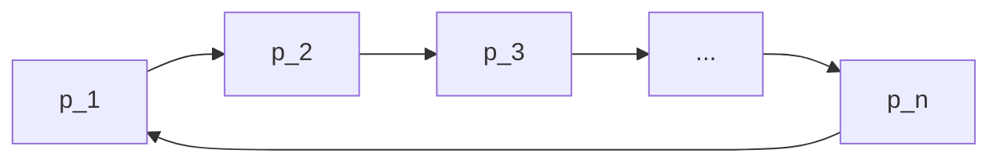

# Reference: Target Matching Algorithms and Graph Constraints

This document provides the mathematical specification and algorithmic definition of the bipartite matching engine implemented in `secretsanta/game_state.py`. It details derangement formulas, Hamiltonian cycle construction, exclusion graph constraints, Minimum Remaining Values (MRV) backtracking, and cycle breakdown prevention.

---

## 1. Problem Formulation

Let $V = \{p_1, p_2, \dots, p_n\}$ denote the set of $n$ participants. The matching problem seeks a bijective mapping:

$$f: V \to V$$

subject to the following invariant constraints:

1. **Injective & Surjective (Bipartite 1-to-1 Matching)**:
   $$\forall p_i, p_j \in V, \quad p_i \neq p_j \implies f(p_i) \neq f(p_j)$$
   $$\bigcup_{p \in V} \{f(p)\} = V$$
2. **Zero Self-Assignment (Derangement Invariant)**:
   $$\forall p \in V, \quad f(p) \neq p$$
3. **Exclusion Graph Satisfaction**:
   Given a directed exclusion graph $G_{\text{excl}} = (V, E_{\text{excl}})$ where $(u, v) \in E_{\text{excl}}$ denotes that participant $u$ cannot be assigned target $v$:
   $$\forall u \in V, \quad (u, f(u)) \notin E_{\text{excl}}$$
4. **Single-Cycle Preference ($N \ge 3$)**:
   $$\operatorname{ord}(f) = n \quad (\text{The cycle decomposition of } f \text{ contains exactly one cycle of length } n)$$

---

## 2. Mathematical Foundations of Derangements

A permutation with no fixed points is a **derangement**. The number of derangements of an $n$-element set, denoted $D_n$ or $!n$, is given by the inclusion-exclusion principle:

$$D_n = n! \sum_{k=0}^{n} \frac{(-1)^k}{k!} = n! \left( 1 - \frac{1}{1!} + \frac{1}{2!} - \frac{1}{3!} + \dots + \frac{(-1)^n}{n!} \right)$$

As $n \to \infty$, the summation converges to $\frac{1}{e}$:

$$D_n = \left[ \frac{n!}{e} \right] \quad (\text{nearest integer for } n \ge 1)$$

### Derangement Values and Probability Matrix

The probability $P(n) = \frac{D_n}{n!}$ that a uniform random permutation has zero fixed points:

| Participants ($n$) | Total Permutations ($n!$) | Derangements ($D_n$) | Probability $P(n) = D_n / n!$ |
| :--- | :--- | :--- | :--- |
| **2** | 2 | 1 | 0.500000 |
| **3** | 6 | 2 | 0.333333 |
| **4** | 24 | 9 | 0.375000 |
| **5** | 120 | 44 | 0.366667 |
| **6** | 720 | 265 | 0.368056 |
| **7** | 5,040 | 1,854 | 0.367857 |
| **8** | 40,320 | 14,833 | 0.367882 |
| **10** | 3,628,800 | 1,334,961 | 0.367879 |
| **$n \to \infty$** | $n!$ | $\approx n!/e$ | $1/e \approx 0.367879$ |

---

## 3. Pre-Flight Feasibility Verification

Prior to executing graph search, `solve_matching` runs two $O(n^2)$ deterministic checks:

### 3.1 Out-Degree (Giver Feasibility) Check

For each participant $p \in V$, compute the valid candidate target set:

$$\operatorname{ValidTargets}(p) = V \setminus \left( \operatorname{Exclusions}(p) \cup \{p\} \right)$$

$$\forall p \in V, \quad |\operatorname{ValidTargets}(p)| \ge 1$$
*If any participant has an empty valid target set, execution halts immediately with an exclusion error.*

### 3.2 In-Degree (Receiver Coverage) Check

For each target $t \in V$, compute the set of eligible givers:

$$\operatorname{EligibleGivers}(t) = \{p \in V \mid t \in \operatorname{ValidTargets}(p)\}$$

$$\forall t \in V, \quad |\operatorname{EligibleGivers}(t)| \ge 1$$
*If any target has no permitted giver, matching is mathematically impossible.*

---

## 4. Directed Hamiltonian Cycle Algorithm (Strategy 1)

When $N \ge 3$ and `prefer_single_cycle = True`, the engine first attempts to construct a single directed Hamiltonian cycle:

$$p_{\pi(1)} \to p_{\pi(2)} \to \dots \to p_{\pi(n)} \to p_{\pi(1)}$$



### 4.1 Algorithmic Specification

```
Input: Set of participants V, ValidTargets map
Output: Match dictionary {giver: receiver} or Failure

FOR iteration = 1 TO 400 DO:
    shuffled = UniformRandomShuffle(V)
    path = [ shuffled[0] ]
    used = { shuffled[0] }
    is_valid = True

    FOR step = 1 TO (n - 1) DO:
        curr = path[step - 1]
        candidates = { t in ValidTargets[curr] | t not in used }
        IF candidates is EMPTY THEN:
            is_valid = False
            BREAK
        next_target = RandomChoice(candidates)
        path.append(next_target)
        used.add(next_target)

    IF is_valid THEN:
        last_node = path[n - 1]
        start_node = path[0]
        IF start_node in ValidTargets[last_node] THEN:
            matches = {}
            FOR i = 0 TO n - 2 DO:
                matches[ path[i] ] = path[i + 1]
            matches[ path[n - 1] ] = path[0]
            RETURN True, matches

RETURN False (Proceed to Strategy 2)
```

### 4.2 Properties

- **Complexity**: $O(400 \times n)$ worst-case time complexity.
- **Cycle Breakdown Invariant**: Completely precludes isolated 2-cycles ($a \leftrightarrow b$) or subcycles for all $n \ge 3$.

---

## 5. MRV Backtracking Algorithm (Strategy 2)

If the Hamiltonian search fails to close within 400 iterations (typically due to disjoint exclusion graphs such as multiple couples or departmental silos), the engine activates randomized constraint satisfaction backtracking.

### 5.1 Minimum Remaining Values (MRV) Ordering

Givers are sorted ascending by the cardinality of their candidate domains:

$$\operatorname{Givers}_{\text{ordered}} = \operatorname{sort}\left(V, \text{key} = \lambda p: |\operatorname{ValidTargets}(p)|\right)$$

This implements the **Fail-First Principle**: participants with the fewest allowable choices are assigned first to prune branches early.

### 5.2 Dynamic Value Ordering & 2-Cycle Suppression

When iterating through candidate targets for a giver $g$:

1. Remaining unassigned candidates are randomly shuffled to preserve non-deterministic assignment.
2. If $n \ge 4$, candidate values are re-sorted to penalize 2-cycles:

$$\operatorname{Penalty}(c) = \begin{cases}
1 & \text{if } c \in \operatorname{Matches} \land \operatorname{Matches}[c] = g \quad (\text{reciprocal 2-cycle}) \\
0 & \text{otherwise}
\end{cases}$$

$$\operatorname{Candidates}_{\text{sorted}} = \operatorname{sort}(\operatorname{Candidates}, \text{key} = \operatorname{Penalty})$$

This prioritizes targets that do not close an immediate 2-cycle loop, preserving open paths for subsequent variables.

### 5.3 Recursive Search Procedure

```
FUNCTION backtrack(index, ordered_givers, assigned_targets, matches):
    IF index == len(ordered_givers) THEN:
        RETURN True

    giver = ordered_givers[index]
    candidates = [ t for t in ValidTargets[giver] if t not in assigned_targets ]
    RandomShuffle(candidates)
    
    IF n >= 4 THEN:
        candidates.sort(key = lambda c: 1 if matches.get(c) == giver else 0)

    FOR cand IN candidates DO:
        matches[giver] = cand
        assigned_targets.add(cand)
        
        IF backtrack(index + 1, ordered_givers, assigned_targets, matches) THEN:
            RETURN True
            
        assigned_targets.remove(cand)
        del matches[giver]

    RETURN False
```

---

## 6. Mathematical Verification Matrix

| Participant Count ($N$) | Theoretical State Space ($N!$) | Derangement Space ($D_N$) | Strategy 1 Max Iterations | 2-Cycle Guarantee |
| :--- | :--- | :--- | :--- | :--- |
| **$N = 2$** | 2 | 1 | 400 | 2-cycle mandatory ($a \leftrightarrow b$) |
| **$N = 3$** | 6 | 2 | 400 | Single 3-cycle ($a \to b \to c \to a$) |
| **$N = 4$** | 24 | 9 | 400 | 0% 2-cycles in Strategy 1; suppressed in Strategy 2 |
| **$N = 8$** | 40,320 | 14,833 | 400 | Single unified 8-cycle |
| **$N = 16$** | $2.09 \times 10^{13}$ | $7.70 \times 10^{12}$ | 400 | Single unified 16-cycle |
| **$N = 64$** | $1.27 \times 10^{89}$ | $4.67 \times 10^{88}$ | 400 | Single unified 64-cycle |
